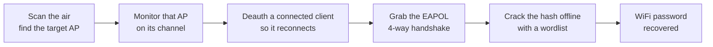

# WiFi Hacking and Penetration Testing Guide

A hands-on WiFi hacking and penetration testing guide, written from my own lab notes. It walks the full wireless workflow the way I run it on an authorised engagement: recon, monitor mode, capturing a WPA/WPA2 handshake, cracking it offline, WPS, the evil twin, and just as importantly how a blue team detects and shuts all of this down.

It shows how a real attacker actually attacks, then replicates those same attacks in a lab you control, so you understand each one hands-on and not just in theory.

## How a hacker cracks a WiFi password

The handshake capture is the first and most widely used attack on a WPA/WPA2 network. Five steps:

1. **Scan and find the AP.** Put the adapter in monitor mode and list every nearby network and its clients (`airodump-ng`). Pick the in-scope target and note its BSSID and channel.
2. **Monitor that AP.** Lock onto the one AP on its channel and write to disk, so anything interesting is captured.
3. **Deauth a client.** Send a short, forged deauthentication so one connected device drops and reconnects. That reconnect is when the handshake happens.
4. **Grab the handshake.** As the client rejoins, `airodump-ng` captures the EAPOL 4-way handshake: the hash of the password, not the password itself.
5. **Crack it offline.** Take the capture away from the network and guess the passphrase against the hash with a wordlist (`hashcat`). Weak or common passwords fall; long random ones do not.

The password never travels over the air. You only ever capture the material to guess it later, away from the target. Corporate WPA2-Enterprise has no shared password, so it uses a different method (covered later in the guide).

## Set up the lab: Linux and a packet-injection adapter

Two things before any command.

**1. Boot a real Linux system, not VirtualBox.** Run **Kali** or **Parrot** as a dual boot or from a **live USB**, so the wireless card talks straight to the kernel. In VirtualBox or VMware you have to pass the USB adapter through, and monitor mode and injection are flaky or fail outright. A real boot is the reliable choice.

**2. Use an external adapter that supports packet injection.** Do not rely on your laptop's internal card: most (especially Intel) cannot inject, and tying up your only card is risky. An external USB adapter keeps your normal WiFi free and is the one piece of kit that actually matters. Monitor mode is a software mode and does **not** harm the adapter.

### Which adapter to buy

The chipset is everything. These have solid monitor mode and injection on Linux.

| Adapter | Chipset | Bands | Amazon | AliExpress |
| --- | --- | --- | --- | --- |
| **Alfa AWUS036NHA** (classic, rock-solid injection) | Atheros AR9271 | 2.4GHz | [Amazon](https://www.amazon.com/s?k=Alfa+AWUS036NHA) | [AliExpress](https://www.aliexpress.com/w/wholesale-alfa-awus036nha.html) |
| **Alfa AWUS036ACM** (best modern dual-band) | MediaTek MT7612U | 2.4 / 5GHz | [Amazon](https://www.amazon.com/s?k=Alfa+AWUS036ACM) | [AliExpress](https://www.aliexpress.com/w/wholesale-alfa-awus036acm.html) |
| **Alfa AWUS036ACH** (long range, dual-band) | RTL8812AU | 2.4 / 5GHz | [Amazon](https://www.amazon.com/s?k=Alfa+AWUS036ACH) | [AliExpress](https://www.aliexpress.com/w/wholesale-alfa-awus036ach.html) |
| **TP-Link TL-WN722N v1** (only v1) | Atheros AR9271 | 2.4GHz | [Amazon](https://www.amazon.com/s?k=TP-Link+TL-WN722N+v1) | [AliExpress](https://www.aliexpress.com/w/wholesale-tl-wn722n.html) |
| **TP-Link Archer T2U Plus** (budget, ~1000 INR) | RTL8821AU | 2.4 / 5GHz | [Amazon](https://www.amazon.com/s?k=TP-Link+Archer+T2U+Plus) | [AliExpress](https://www.aliexpress.com/w/wholesale-archer-t2u-plus.html) |

- **Alfa** adapters ship worldwide and are the most reliable; the **AWUS036ACM** is my top pick (dual-band, in-kernel driver, no out-of-tree mess).
- **TP-Link** is a cheaper way to learn on, but monitor mode is less reliable. For the **TL-WN722N get v1 only**: v2 and v3 use a Realtek chip that needs patched drivers.
- Avoid the TP-Link Archer T3U Plus (RTL8812BU): it needs an out-of-tree driver and injection is unreliable.

