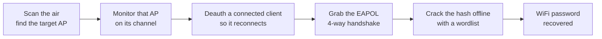

# WiFi Hacking and Penetration Testing Guide

A hands-on WiFi hacking and penetration testing guide, written from my own lab notes. It walks the full wireless workflow the way I run it on an authorised engagement: recon, monitor mode, capturing a WPA/WPA2 handshake, cracking it offline, WPS, the evil twin, and just as importantly how a blue team detects and shuts all of this down.

It shows how a real attacker actually attacks, then replicates those same attacks in a lab you control, so you understand each one hands-on and not just in theory.

## How a hacker cracks a WiFi password

The handshake capture is the first and most widely used attack on a WPA/WPA2 network. Five steps:

1. **Scan and find the AP.** Put the adapter in monitor mode and list every nearby network and its clients (`airodump-ng`). Pick the in-scope target and note its BSSID and channel.
2. **Monitor that AP.** Lock onto the one AP on its channel and write to disk, so anything interesting is captured.
3. **Deauth a client.** Send a short, forged deauthentication so one connected device drops and reconnects. That reconnect is when the handshake happens.
4. **Grab the handshake.** As the client rejoins, `airodump-ng` captures the EAPOL 4-way handshake: the hash of the password, not the password itself.
5. **Crack it offline.** Take the capture away from the network and guess the passphrase against the hash with a wordlist (`hashcat`). Weak or common passwords fall; long random ones do not.

The password never travels over the air. You only ever capture the material to guess it later, away from the target. Corporate WPA2-Enterprise has no shared password, so it uses a different method (covered later in the guide).

